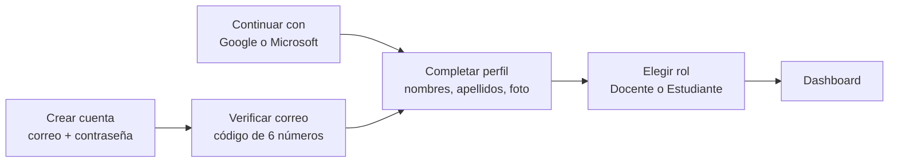
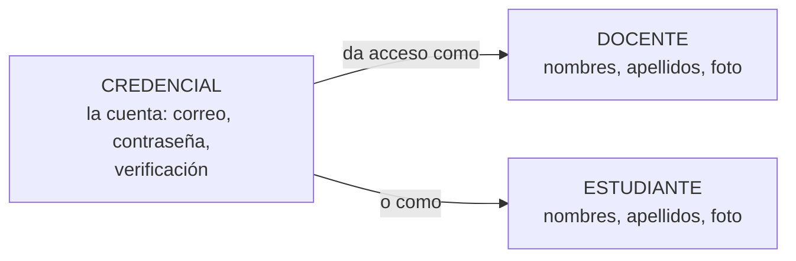

# Módulo 1 — Acceso y perfil

**Entrega:** I1, la primera. **Es la "columna vertebral"** que revisó el
docente el 2026-10-22: sin ella, nadie entra al sistema.
**Estado:** el backend está construido en su mayoría; el frontend no.

---

## 1. En dos frases

Es la puerta de entrada de AdaptiveLearn: permite crear una cuenta,
confirmar que el correo es real, elegir si se es **docente o
estudiante**, entrar y salir, y recuperar la contraseña. Existe porque
el sistema guarda datos de menores de edad y tiene que saber con
certeza quién es cada persona y qué puede ver.

## 2. Un ejemplo de principio a fin

**Ana es docente de matemáticas.**

1. Entra a AdaptiveLearn y elige **Crear cuenta**. Escribe su correo y
   una contraseña (mínimo 8 caracteres, con una mayúscula, una minúscula y un número).
2. El sistema le **envía un código de 6 números** a su correo. Ana lo
   escribe. Si no le llega, puede pedir otro cada 30 segundos.
3. Escribe sus **nombres y apellidos**, y si quiere, sube una foto.
4. Elige **"Soy Docente"**. El sistema le avisa que no podrá cambiarlo
   después.
5. Entra a su **Dashboard**. Desde ahí puede editar su perfil (foto,
   nombres, apellidos) o cerrar sesión.

**Semanas después, Ana olvida su contraseña.** Elige "¿Olvidaste tu
contraseña?", escribe su correo, recibe un código, lo escribe y define
una contraseña nueva.

**Pedro, estudiante de 8°**, hace lo mismo, pero con el botón
**"Continuar con Google"**: no necesita contraseña ni código, porque
Google ya confirmó su correo. Elige "Soy Estudiante".

## 3. El dibujo

El camino de registro:

Lo que se guarda, y cómo se relaciona:

Una credencial da acceso a **uno solo** de los dos, nunca a ambos.

## 4. Las tres capas

### Lo que se ve: las pantallas (frontend)

Seis pantallas más una ventana, ya diseñadas al detalle en la Fase II
(medidas, colores, textos y comportamiento). **Todavía no están
programadas.**

| Ventana | Pantalla | Diseño |
|---|---|---|
| 014 | Iniciar sesión / Crear cuenta | `17-spec-auth-login-registro.md` |
| 015 | Verifica tu correo | `18-spec-auth-verifica-correo.md` |
| 016 | Completa tu perfil | `19-spec-auth-completa-perfil.md` |
| 017 | Elige tu rol | `20-spec-auth-elige-rol.md` |
| 018 | Recupera tu contraseña | `21-spec-auth-recupera-contrasena.md` |
| 019 | Nueva contraseña | `22-spec-auth-nueva-contrasena.md` |
| 026 | Mi perfil (ventana) | `26-spec-modal-mi-perfil.md` |

(Todas en `docs/modesec/fase-2-diseno-multimedial/`.)

### Lo que lo hace funcionar: el backend

El backend recibe **pedidos** desde las pantallas y responde. Cada tipo
de pedido es un **endpoint** (una "dirección" a la que se le pide algo).
El módulo tiene 13:

| Qué pide la pantalla | Endpoint | Estado |
|---|---|---|
| Crear la cuenta | `POST /auth/register` | Hecho |
| Confirmar el código del correo | `POST /auth/verificar-correo` | Hecho |
| Reenviar el código | `POST /auth/reenviar-codigo` | Hecho |
| Entrar con Google | `POST /auth/google` | **Falta** |
| Entrar con Microsoft | `POST /auth/microsoft` | **Falta** |
| Elegir el rol | `POST /auth/elegir-rol` | Por ajustar |
| Iniciar sesión | `POST /auth/login` | Hecho |
| Pedir recuperar la contraseña | `POST /auth/recuperar-contrasena` | Hecho |
| Confirmar el código de recuperación | `POST /auth/recuperar-contrasena/verificar` | Hecho |
| Guardar la contraseña nueva | `POST /auth/nueva-contrasena` | Hecho |
| Ver mi perfil | `GET /auth/profile` | Hecho |
| Editar mi perfil | `PATCH /users/:id` | Por ajustar |
| Cerrar sesión | `POST /auth/cerrar-sesion` | Opcional |

Fuente: `docs/modesec/fase-3-diseno-computacional/20-catalogo-endpoints.md`, sección 3.
Código: `backend/src/auth/`.

### Lo que se guarda: la base de datos

Tres tablas: **credencial** (la cuenta), **docente** y **estudiante**.
Del estudiante se guardan **solo** nombres, apellidos y foto opcional, y
su correo, que vive en su credencial; nunca fecha de nacimiento,
documento ni colegio (ADR-029).
Las contraseñas **nunca** se guardan tal cual: se guarda una versión
cifrada que no se puede revertir (un *hash*).

## 5. Las decisiones importantes, y por qué

| Decisión | Por qué | Fuente |
|---|---|---|
| **El rol no se cambia nunca** | Docente y estudiante son tablas distintas, con datos y permisos distintos | `20-spec`, ADR-034 |
| **El correo es único entre docentes y estudiantes** | Una misma persona no puede tener una cuenta de cada tipo con el mismo correo; por eso el correo vive en la credencial, no en docente ni en estudiante | ADR-034 |
| **Google y Microsoft, pero no Apple** | Apple exige una cuenta de desarrollador de pago (99 USD al año), y esta es una aplicación web | `17-spec` |
| **Al recuperar la contraseña, el sistema no dice si el correo existe** | Para que un extraño no pueda averiguar quién tiene cuenta (se llama "enumeración de cuentas") | `21-spec`, RNF-07 |
| **El código vale 10 minutos y tiene 5 intentos** | Hay un millón de códigos posibles; sin límite, se podrían probar todos | `backend/sql/002…` |
| **5 intentos fallidos al entrar bloquean la cuenta 15 minutos** | Para frenar a quien intenta adivinar contraseñas | `backend/src/auth/auth.service.ts` |
| **No hay casilla de "acepto términos"** | Ese documento no existe todavía, y fingirlo sería peor que no tenerlo | `17-spec` |
| **Esta versión no se usa con estudiantes reales** | La ley exige la autorización del acudiente para tratar datos de menores, y el sistema todavía no la registra | ADR-029, Ley 1581 de 2012 |

## 6. Qué está hecho y qué falta

**Hecho:** 8 de los 13 endpoints del backend, con el bloqueo por
intentos y el cifrado de contraseñas.

**Falta o hay que ajustar:**
- **El frontend completo** (las 7 pantallas).
- **Entrar con Google y Microsoft** (2 endpoints).
- **Ajustes pedidos por el docente el 2026-10-22**
  (`docs/modesec/fase-3-diseno-computacional/21-revision-docente-2026-10-22.md`):
  - que el sistema trabaje con *docente* y *estudiante*, no con un
    "usuario" genérico (hoy el backend tiene una entidad `User` heredada
    de la guía del curso);
  - que la verificación del correo sea un estado ("procesando" /
    "verificado") en vez de sí/no (ADR-037);
  - un correo propio del sistema (`adaptivelearn@…`) para enviar los
    códigos;
  - qué hacer con los campos del vencimiento del código, **pendiente
    de que el docente responda**.
- **Alinear las tablas del backend con el modelo final:** hoy docente y
  estudiante todavía guardan "nombre" en una sola casilla y el correo
  repetido.

## 7. Preguntas probables del docente

**¿Por qué hay una tabla de credencial además de docente y estudiante?**
Porque el código de verificación hay que guardarlo *antes* de que la
persona elija si es docente o estudiante, y porque el correo tiene que
ser único entre los dos tipos de cuenta (ADR-034).

**¿Cómo saben que la contraseña está segura?**
No se guarda la contraseña, sino un *hash* (con bcrypt): una versión
cifrada que no se puede revertir. Al entrar, se cifra lo que la persona
escribe y se comparan los dos resultados.

**¿Qué pasa si alguien intenta adivinar el código o la contraseña?**
El código tiene 5 intentos y vence en 10 minutos; el inicio de sesión
se bloquea 15 minutos después de 5 intentos fallidos.

**¿Por qué el estudiante no puede cambiar a docente?**
Porque son dos tipos de cuenta con permisos distintos, y el sistema se
lo advierte antes de elegir.

**¿Pueden usarlo con estudiantes de verdad?**
Todavía no: falta registrar la autorización del acudiente que exige la
Ley 1581 de 2012. Esta versión es una demostración para docentes.

## 8. Si te preguntan algo que no sabes

- **Di lo que sí sabes y dónde está el resto:** "Eso está decidido en
  el documento de decisiones del proyecto; lo reviso y le respondo."
- **No inventes un número ni un nombre técnico.** Es mejor "no lo sé con
  exactitud" que una cifra equivocada.
- **Si es algo que falta, dilo:** "Eso todavía no está programado; está
  en la lista de lo que falta para esta entrega."

## 9. Palabras técnicas, en simple

| Palabra | Qué significa |
|---|---|
| **Frontend** | Lo que la persona ve y toca: las pantallas |
| **Backend** | Lo que funciona por detrás: recibe los pedidos de las pantallas, decide y guarda |
| **Endpoint** | Una "dirección" del backend a la que se le pide una cosa concreta (crear cuenta, entrar…) |
| **Base de datos / tabla** | Donde se guarda la información, ordenada en tablas, como hojas de cálculo |
| **Hash** | La contraseña cifrada de forma que no se puede volver atrás |
| **Token (JWT)** | Una "pulsera" que el sistema le entrega a quien entra, para que no tenga que escribir la contraseña en cada paso; vence con el tiempo |
| **Rol** | Si la cuenta es de docente o de estudiante |
| **Enumeración de cuentas** | Averiguar qué correos están registrados probando uno por uno; el sistema lo impide al no responder si un correo existe |
