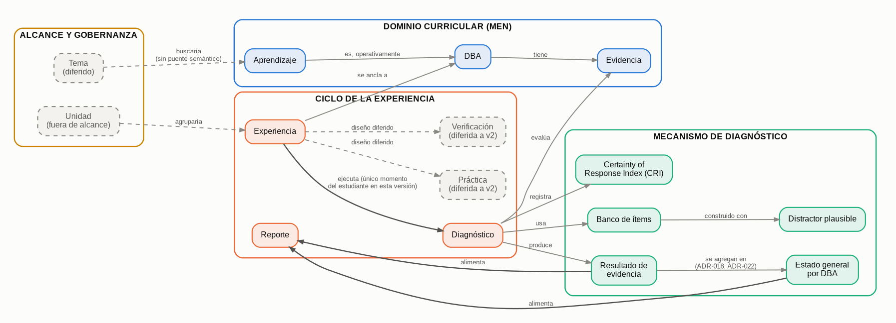

# 2. Diagrama de Contenidos

**Metodología:** MODESEC — Fase II, segunda sub-etapa.

**Precisión de alcance, verificada contra el texto original:** *"La
funcionalidad de los diagramas es representar gráficamente la
información contenida en un estudio temático... complementar el diseño
de un software con un esquema que represente los contenidos que se
encuentran en la fase del diseño de contenidos. Esta representación se
puede esquematizar de distintas formas ya sea por medio de mentefactos,
mapas conceptuales y mapas mentales."* Este diagrama no agrega
información nueva — representa gráficamente los 15 conceptos y sus
relaciones ya definidos en Fase I, sección 6.

## Forma elegida: mapa conceptual

De las 3 formas que el modelo permite, se eligió mapa conceptual porque
las relaciones entre nuestros conceptos son concretas y nombrables
("evalúa", "produce", "alimenta", "se ancla a") — no un árbol de un solo
concepto (mentefacto) ni una asociación libre sin relaciones etiquetadas
(mapa mental).

## Diagrama

*(Generado con Graphviz a partir de `mapa-conceptual-diagrama.dot`, con
diseño automático de nodos y conexiones — sin cruces sobre cajas ajenas.
Color por grupo (paleta categórica validada para daltonismo y contraste),
elementos diferidos o fuera de alcance en gris punteado para no competir
visualmente con lo activo, y la ruta principal —Diagnóstico → Resultado
→ Reporte— resaltada.)*

## Lectura del diagrama, por grupo

- **Dominio curricular (MEN):** DBA tiene Evidencia; Aprendizaje es,
  operativamente, un DBA.
- **Ciclo de la experiencia:** Experiencia se ancla a un DBA y ejecuta
  Diagnóstico — el único momento que el estudiante atraviesa en esta
  versión. Reporte **no** es algo que Experiencia ejecute en paralelo:
  llega indirectamente, alimentado por el Resultado de evidencia que
  Diagnóstico produce (ver grupo siguiente) — es una capa que agrega,
  no un momento del estudiante (ver `/diseno/glosario.md`, entrada
  "Reporte"). Práctica y Verificación tienen diseño diferido a v2
  (líneas punteadas, para distinguir lo diferido de lo activo).
- **Mecanismo de diagnóstico:** Diagnóstico evalúa Evidencia, usa el
  Banco de ítems (construido con distractores plausibles), registra
  CRI, y produce un Resultado de evidencia. Esos resultados, agregados
  por estudiante, dan el **Estado general por DBA** (ADR-018, revisado
  por ADR-022, que le agrega el cuarto estado "sin concluir"). Reporte
  se alimenta de los dos: del detalle por evidencia y del agregado.
- **Alcance y gobernanza:** Unidad agruparía Experiencias (fuera de
  alcance); Tema buscaría sobre Aprendizaje, pero diferido — no tiene
  puente semántico construido (líneas punteadas, igual que lo diferido).

**Fuente de cada relación:** `/diseno/decisiones.md` (ADR-001, ADR-005,
ADR-007, ADR-008, ADR-016 —que reemplaza a ADR-009—, ADR-018 y ADR-022)
y `/diseno/glosario.md`, ya resumidos en
`fase-1-diseño-educativo/06-diseno-contenidos.docx`.

*(Correcciones 2026-08-26: el conteo decía 14 conceptos —quedó en 15 al
incorporar el Estado general por DBA, que ADR-018/022 definieron y la
lista de Fase I no tenía—; se citaba ADR-009, reemplazado por ADR-016; y
la referencia al documento de Fase I apuntaba a `.md` cuando el archivo
es `.docx`. El diagrama se regeneró desde el `.dot` con el concepto y sus
dos relaciones nuevas.)*
