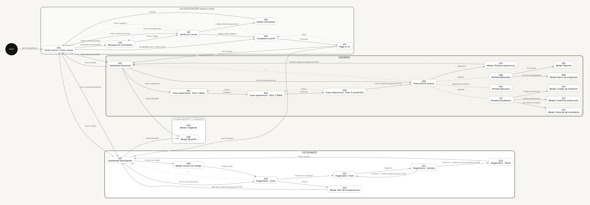

# 4. Mapa de navegación

**Metodología:** MODESEC — Fase II, punto 4.

MODESEC lo define como *"una guía gráfica que se elabora para brindarle
al usuario un fácil manejo del material computacional. Este esquema
muestra la forma como están organizadas las interfaces gráficas de
usuario"*, incluyendo la ventana principal y el despliegue de las
demás cuando un vínculo las conecta.



Versión ampliable sin pérdida: `navegacion/mapa-navegacion.svg`.

## Cómo se lee

- **Cada caja es una ventana**, con su número y su nombre. El número es
  el mismo de su especificación (`04` a `27`) y del guión técnico
  (`29-guion-tecnico.md`).
- **Tres zonas:** autenticación (la usan los dos roles), docente y
  estudiante. Fuera de ellas están los componentes comunes.
- **Flecha continua:** la acción del usuario que lleva de una ventana a
  otra, con el nombre del botón o vínculo que la dispara.
- **Flecha punteada:** volver a la pantalla anterior.
- **Línea discontinua sin punta:** cambio de pestaña dentro de la Vista
  Interna (Resumen, Materiales, Estudiantes).
- **Caja de borde discontinuo (024, Cargando):** aparece entre muchas
  acciones y la pantalla siguiente mientras se espera al servidor. Para
  que el mapa siga siendo legible no se dibujan todas sus flechas; las
  acciones que pasan por ella lo dicen en su etiqueta ("pasa por 024").

**Dos convenciones que el mapa no dibuja**, para no duplicar flechas:
1. **Un modal, al cerrarse, vuelve a la ventana que lo abrió.** Solo se
   dibuja la salida cuando lleva a otro lugar (025 → 001).
2. **El Sidebar** (bloque de perfil → 026, "Mis experiencias" → 001,
   "Cerrar sesión" → 014) está en 001, 006 y 020. El mapa dibuja esas
   flechas solo desde 001.

## Recorridos principales

| Recorrido | Ventanas |
|---|---|
| Registrarse con correo | 014 → 015 → 016 → 017 → 001 |
| Registrarse con Google o Microsoft | 014 → 016 → 017 → 001 (sin verificación de correo: la hizo el proveedor) |
| Recuperar la contraseña | 014 → 018 → 015 → 019 → 014 |
| Docente: crear y publicar una experiencia | 001 → 002 → 003 → 004 → (024) → 006 → 008 → 009 (revisar banco) → 011 → 012 |
| Docente: ver resultados | 001 → 006 → 008 → 010 (Reporte), o 006 → 011 → 027 (historial de un estudiante) |
| Estudiante: hacer el diagnóstico | 001 → 005 → 020 → 021 ⇄ 022 … → 023 → 001 |

## Cómo se mantiene

El mapa **no se dibuja a mano.** Sale de
`navegacion/mapa_navegacion.py`, que guarda en un solo lugar la lista
de ventanas y de flechas. El mismo script genera la tabla de ventanas
del guión técnico, y antes de generar nada **verifica**:

1. que toda ventana especificada (`# Ventana NNN` en los specs) esté en
   el mapa, y que todo nodo del mapa tenga su especificación;
2. que ninguna flecha salga o llegue a una ventana inexistente;
3. que toda ventana (salvo el componente genérico 024) sea alcanzable
   desde Inicio, es decir, que no haya pantallas huérfanas.

Se probó que el verificador atrapa los 3 tipos de error, introduciéndolos
a propósito (2026-10-21). Resultado actual:

```
$ python3 navegacion/mapa_navegacion.py
OK — 27 ventanas especificadas, todas en el mapa; 50 flechas, todas con
extremos validos; todas las pantallas alcanzables desde Inicio.
```
