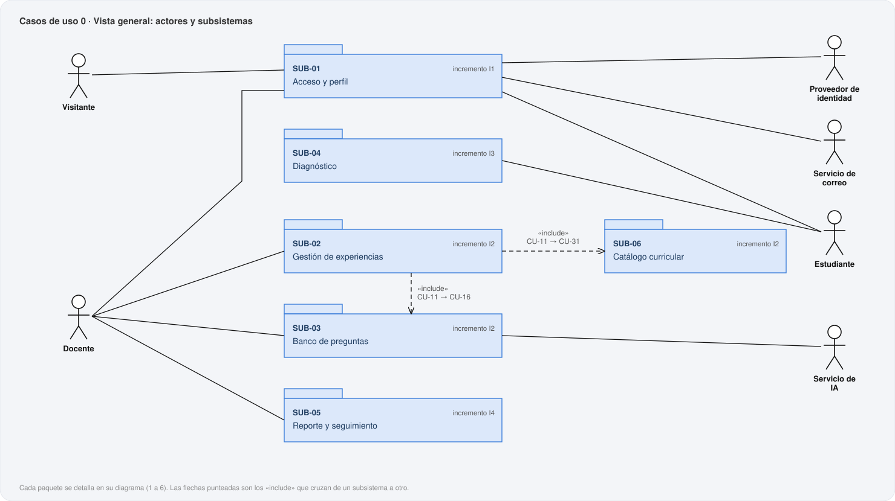
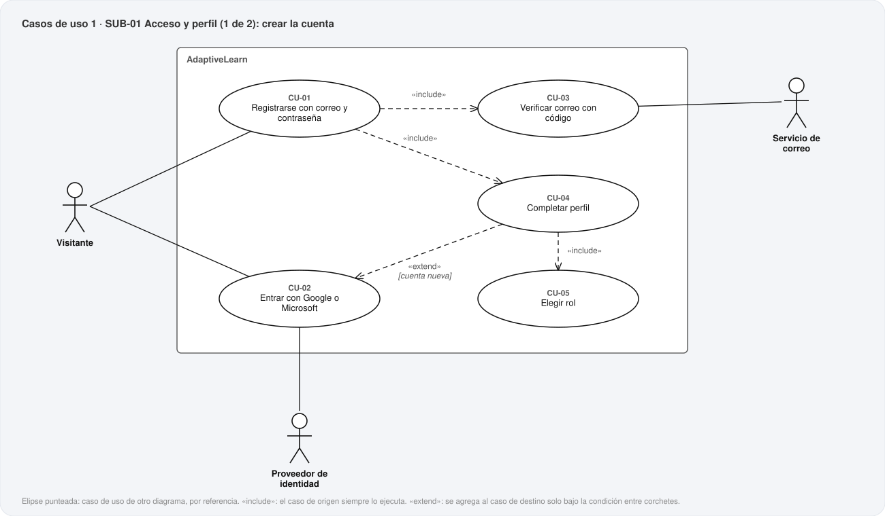
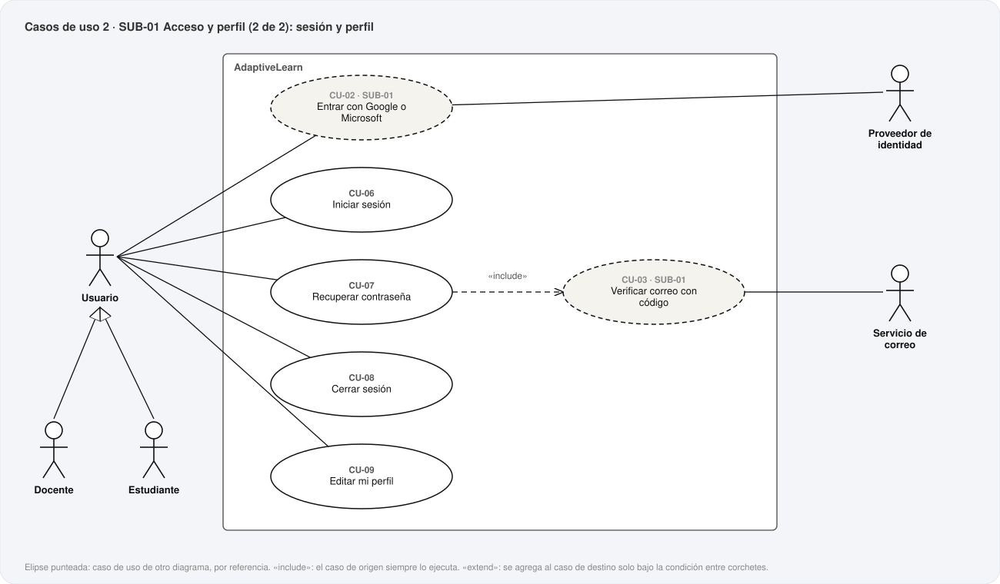
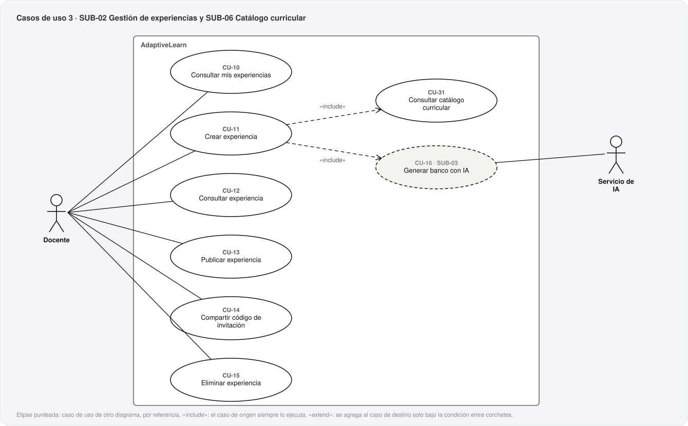
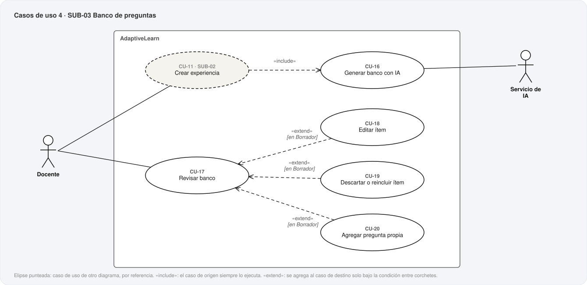
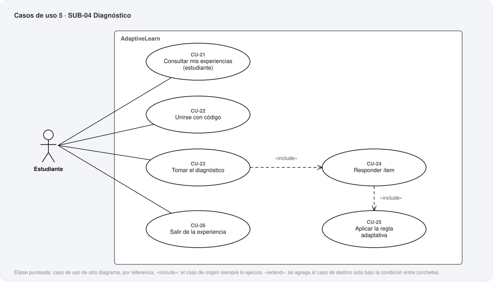
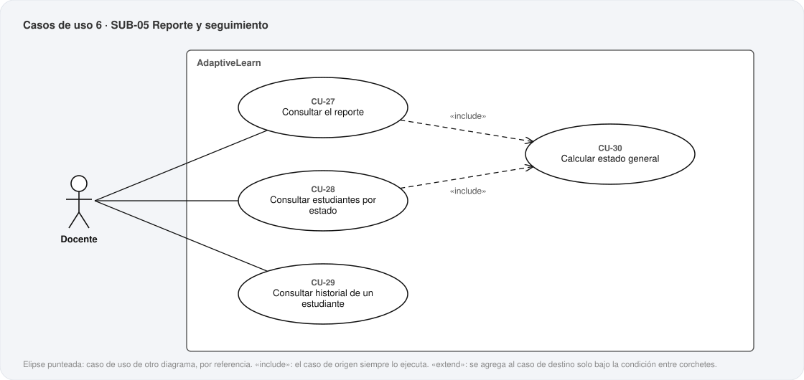

# 12. Casos de uso

**Metodología:** MODESEC — Fase III, Diseño Computacional, tercera sub-etapa.
**Fecha:** 2026-10-21. **Archivo generado** por `uml/generar_uml.py`; no se edita a mano.

MODESEC define el caso de uso como la especificación del *«comportamiento de un sistema o
de una parte del mismo»*, una *«descripción de un conjunto de secuencias de acciones,
incluyendo variantes, que ejecuta un sistema para producir un resultado observable de
valor para un actor»*, y les pide dos objetivos: *«Definir los requisitos funcionales del
sistema y proporcionar una base para la validación de las pruebas»*. Por eso cada caso de
uso de este documento dice qué requerimientos de `11-analisis-requerimientos.md` cubre, y
trae una **prueba de aceptación**: un caso concreto que, al construir el incremento, dice
si quedó bien hecho.

**31 casos de uso** en **7 diagramas** (uno general y uno por subsistema). Cubren los **44 requerimientos funcionales** del análisis, sin excepción.

## 1. Actores

| Actor | Quién es |
|---|---|
| **Visitante** | Persona que todavía no tiene cuenta, o que aún no inició sesión. Es el actor de RF-01-01 a RF-01-06. |
| **Usuario** | Docente o Estudiante con cuenta. Generaliza a los dos para lo que hacen igual: iniciar y cerrar sesión, recuperar la contraseña, editar su perfil. |
| **Docente** | Crea experiencias, revisa y completa el banco, publica, comparte el código y consulta el reporte (`10`, §2.2). |
| **Estudiante** | Se une con un código y responde el diagnóstico (`10`, §2.2). |
| **Servicio de IA** | Externo. Gemini y DeepSeek, uno principal y otro de respaldo (ADR-030). |
| **Proveedor de identidad** | Externo. Google o Microsoft (RF-01-02). |
| **Servicio de correo** | Externo. Entrega los códigos de verificación y de recuperación. |

## 2. Cómo leer los diagramas

- **Elipse:** un caso de uso. **Monigote:** un actor. **Rectángulo «AdaptiveLearn»:** el límite del sistema.
- **«include»** (flecha punteada): el caso de origen **siempre** ejecuta al de destino — por ejemplo, registrarse siempre incluye verificar el correo.
- **«extend»** (flecha punteada): el caso de origen se agrega al de destino **solo bajo la condición** entre corchetes — por ejemplo, completar perfil extiende a entrar con Google solo si la cuenta es nueva.
- **Elipse punteada y crema:** un caso de uso de otro diagrama, dibujado por referencia para mostrar un «include» o un «extend». Cada caso de uso es *propio* de un solo diagrama: misma regla de las costuras del MER.
- **Triángulo hueco:** generalización entre actores. Docente y Estudiante son Usuarios.

## 3. Diagramas

### Casos de uso 0 · Vista general

### Casos de uso 1 · SUB-01 Acceso y perfil (1 de 2): crear la cuenta

### Casos de uso 2 · SUB-01 Acceso y perfil (2 de 2): sesión y perfil

### Casos de uso 3 · SUB-02 Gestión de experiencias y SUB-06 Catálogo curricular

### Casos de uso 4 · SUB-03 Banco de preguntas

### Casos de uso 5 · SUB-04 Diagnóstico

### Casos de uso 6 · SUB-05 Reporte y seguimiento

## 4. Resumen por subsistema

| Subsistema | Incremento | Casos de uso |
|---|---|---|
| **SUB-01** Acceso y perfil | I1 | CU-01, CU-02, CU-03, CU-04, CU-05, CU-06, CU-07, CU-08, CU-09 |
| **SUB-02** Gestión de experiencias | I2 | CU-10, CU-11, CU-12, CU-13, CU-14, CU-15 |
| **SUB-03** Banco de preguntas | I2 | CU-16, CU-17, CU-18, CU-19, CU-20 |
| **SUB-04** Diagnóstico | I3 | CU-21, CU-22, CU-23, CU-24, CU-25, CU-26 |
| **SUB-05** Reporte y seguimiento | I4 | CU-27, CU-28, CU-29, CU-30 |
| **SUB-06** Catálogo curricular | I2 | CU-31 |

## 5. Especificación de cada caso de uso

### SUB-01 — Acceso y perfil

#### CU-01 — Registrarse con correo y contraseña

| Actor | Actores secundarios | Requerimientos | Ventanas | Incremento |
|---|---|---|---|---|
| Visitante | Servicio de correo | RF-01-01, RF-01-04 | 014, 015 | I1 |

**Relaciones:** «include» CU-03; «include» CU-04.

**Precondición:** El visitante no ha iniciado sesión.

**Flujo principal**

1. El visitante elige «Crear cuenta» y escribe su correo y una contraseña.
2. El sistema habilita el botón solo cuando la contraseña tiene mínimo 8 caracteres, una mayúscula y un número.
3. El visitante confirma.
4. El sistema comprueba que el correo no esté registrado.
5. El sistema guarda la credencial con la contraseña cifrada (RNF-08).
6. Se incluye CU-03 Verificar correo con código.
7. Se incluye CU-04 Completar perfil.

**Flujos alternos**

- 4a. El correo ya está registrado con correo y contraseña: el sistema avisa que la cuenta ya existe; no crea ni modifica nada (RF-01-04).
- 4b. El correo está registrado con Google o Microsoft: el sistema avisa qué método usar; no vincula (RF-01-04).

**Postcondición:** Existe una credencial con el correo verificado, todavía sin rol: la cuenta con rol se crea en CU-05 (RF-01-05, RF-01-06).

**Prueba de aceptación:** Con la contraseña «clave123» el botón queda deshabilitado; con «Clave123» llega un código de 6 dígitos al correo; registrar otra vez el mismo correo muestra que la cuenta ya existe y no crea nada.

#### CU-02 — Entrar con Google o Microsoft

| Actor | Actores secundarios | Requerimientos | Ventanas | Incremento |
|---|---|---|---|---|
| Visitante | Proveedor de identidad | RF-01-02, RF-01-04 | 014, 016 | I1 |

**Relaciones:** lo extiende CU-04.

**Precondición:** Ninguna.

**Flujo principal**

1. La persona elige «Continuar con Google» o «Continuar con Microsoft».
2. El proveedor autentica a la persona y devuelve su identidad: correo, nombres, apellidos y foto.
3. El sistema busca una credencial de ese proveedor con ese identificador.
4. La credencial existe y tiene rol: la persona entra al Dashboard de su rol.

**Flujos alternos**

- 2a. El proveedor rechaza o la persona cancela: vuelve a la ventana de acceso, sin cambios.
- 3a. No existe la credencial: el sistema la crea con el correo ya verificado por el proveedor —sin código— y se extiende con CU-04, con nombres, apellidos y foto prellenados y editables (RF-01-02).
- 3b. El correo ya está registrado con otro método: el sistema avisa cuál usar; no crea ni vincula (RF-01-04).

**Postcondición:** Sesión iniciada; o, si la cuenta es nueva, registro en curso en CU-04.

**Prueba de aceptación:** Una cuenta de Google nueva lleva a completar perfil con los nombres prellenados; la misma cuenta, ya con rol, entra directo al Dashboard; una cuenta de Google cuyo correo ya está registrado con contraseña muestra qué método usar.

> Sin Apple: exige cuenta de desarrollador de pago y la plataforma es web (RF-01-02).

#### CU-03 — Verificar correo con código

| Actor | Actores secundarios | Requerimientos | Ventanas | Incremento |
|---|---|---|---|---|
| Visitante | Servicio de correo | RF-01-03 | 015 | I1 |

**Relaciones:** lo incluye CU-01; lo incluye CU-07.

**Precondición:** Se pidió un código: al registrarse (CU-01) o al recuperar la contraseña (CU-07).

**Flujo principal**

1. El sistema genera un código de 6 dígitos con vencimiento y lo envía con el servicio de correo.
2. La persona escribe el código.
3. El sistema lo compara con el vigente.
4. Coincide: en el registro marca el correo como verificado; en la recuperación habilita la contraseña nueva.

**Flujos alternos**

- 1a. «Reenviar código», habilitado 30 s después del último envío: genera un código nuevo que reemplaza al anterior.
- 3a. Código incorrecto: mensaje de error, sin borrar lo escrito; se cuenta un intento fallido (backend I1).
- 3b. Código vencido: mensaje de error; hay que pedir otro.
- *a. «Volver» regresa al paso anterior de cada flujo.

**Postcondición:** Registro: pasa a completar perfil. Recuperación: pasa a nueva contraseña.

**Prueba de aceptación:** «Reenviar código» está deshabilitado los primeros 30 segundos; un código errado muestra error y conserva lo escrito; el código correcto avanza al paso siguiente de su flujo.

> La misma ventana sirve a los dos flujos (RF-01-03): por eso es un caso de uso propio, incluido por CU-01 y por CU-07.

#### CU-04 — Completar perfil

| Actor | Actores secundarios | Requerimientos | Ventanas | Incremento |
|---|---|---|---|---|
| Visitante | — | RF-01-05 | 016 | I1 |

**Relaciones:** «include» CU-05; «extend» CU-02 [cuenta nueva]; lo incluye CU-01.

**Precondición:** Correo verificado (CU-03) o acceso con proveedor (CU-02).

**Flujo principal**

1. El sistema muestra nombres, apellidos y foto; prellenados si vienen del proveedor.
2. La persona escribe nombres y apellidos y, si quiere, sube una foto JPG o PNG de hasta 5 MB.
3. El sistema recorta la foto en cuadrado y habilita «Continuar» cuando nombres y apellidos están llenos.
4. La persona continúa.
5. Se incluye CU-05 Elegir rol.

**Flujos alternos**

- 2a. Archivo que no es JPG ni PNG, o de más de 5 MB: mensaje de error y la foto no cambia.

**Postcondición:** Perfil completo, pendiente de rol. La cuenta todavía no existe (RF-01-05): estos datos se guardan al elegir el rol.

**Prueba de aceptación:** Con los apellidos vacíos «Continuar» está deshabilitado; una imagen de 6 MB muestra error y la foto no cambia.

#### CU-05 — Elegir rol

| Actor | Actores secundarios | Requerimientos | Ventanas | Incremento |
|---|---|---|---|---|
| Visitante | — | RF-01-06 | 017 | I1 |

**Relaciones:** lo incluye CU-04.

**Precondición:** Perfil completo (CU-04).

**Flujo principal**

1. El sistema muestra las dos opciones, Docente y Estudiante, y advierte que el rol no se puede cambiar después.
2. La persona elige una y confirma.
3. En una sola operación, el sistema crea el docente o el estudiante con los datos del perfil y lo asocia a la credencial.
4. La persona entra al Dashboard de su rol.

**Postcondición:** Existe la cuenta con su rol, fijo para siempre (RF-01-06).

**Prueba de aceptación:** Tras elegir Docente, el Dashboard es el del docente; ninguna pantalla ofrece cambiar el rol.

#### CU-06 — Iniciar sesión

| Actor | Actores secundarios | Requerimientos | Ventanas | Incremento |
|---|---|---|---|---|
| Usuario | — | RF-01-07, RF-01-04 | 014 | I1 |

**Precondición:** La cuenta existe.

**Flujo principal**

1. La persona escribe correo y contraseña.
2. El sistema compara la contraseña con su hash.
3. El sistema abre la sesión y muestra el Dashboard del rol.

**Flujos alternos**

- 2a. Correo o contraseña incorrectos: mensaje de error genérico (RF-01-07); se suma un intento fallido.
- 2b. Demasiados intentos fallidos seguidos: la entrada queda bloqueada por un tiempo (backend I1).
- 2c. El correo es de una cuenta de Google o Microsoft: el sistema avisa qué método usar (RF-01-04).
- 3a. La credencial todavía no tiene rol —registro sin terminar—: continúa en CU-04 Completar perfil.

**Postcondición:** Sesión iniciada.

**Prueba de aceptación:** Con la contraseña errada aparece un mensaje que no distingue si falló el correo o la contraseña; con la correcta entra al Dashboard de su rol.

> El alterno 3a es una decisión de este documento: los requerimientos no dicen qué pasa con un registro a medias, y retomarlo es lo único que no deja inutilizable una cuenta con el correo ya verificado.

#### CU-07 — Recuperar contraseña

| Actor | Actores secundarios | Requerimientos | Ventanas | Incremento |
|---|---|---|---|---|
| Usuario | Servicio de correo | RF-01-08, RF-01-09, RNF-07 | 018, 015, 019 | I1 |

**Relaciones:** «include» CU-03.

**Precondición:** La persona no recuerda su contraseña.

**Flujo principal**

1. La persona elige «¿Olvidaste tu contraseña?» y escribe su correo.
2. El sistema valida solo el formato del correo y avanza siempre a verificar el código, exista o no la cuenta (RNF-07).
3. Si la cuenta existe, se incluye CU-03 Verificar correo con código.
4. La persona escribe la contraseña nueva; «Guardar» se habilita cuando cumple las reglas del registro.
5. El sistema la guarda cifrada y lleva a iniciar sesión con un mensaje de confirmación.

**Flujos alternos**

- 3a. La cuenta no existe: no se envía nada, pero lo que la persona ve es idéntico (RNF-07).

**Postcondición:** La contraseña cambió.

**Prueba de aceptación:** Pedir la recuperación de un correo que no existe lleva a la misma pantalla del código que uno que sí existe; con el código correcto se fija una contraseña nueva, y con ella se entra.

#### CU-08 — Cerrar sesión

| Actor | Actores secundarios | Requerimientos | Ventanas | Incremento |
|---|---|---|---|---|
| Usuario | — | RF-01-10 | 001, 014 | I1 |

**Precondición:** Sesión iniciada.

**Flujo principal**

1. La persona elige «Cerrar sesión» en el menú lateral.
2. El sistema termina la sesión, sin pedir confirmación, y muestra iniciar sesión.

**Postcondición:** Sesión cerrada.

**Prueba de aceptación:** «Cerrar sesión» lleva directo a iniciar sesión, sin ningún diálogo.

#### CU-09 — Editar mi perfil

| Actor | Actores secundarios | Requerimientos | Ventanas | Incremento |
|---|---|---|---|---|
| Usuario | — | RF-01-11 | 026, 001 | I1 |

**Precondición:** Sesión iniciada.

**Flujo principal**

1. La persona hace clic en el bloque de perfil del menú lateral.
2. El sistema muestra nombres, apellidos y foto editables; el correo y el rol, sin edición.
3. La persona cambia lo que quiera; la foto se reemplaza, no se quita.
4. «Guardar cambios» se habilita solo si hay cambios y los dos campos están llenos.
5. El sistema guarda y actualiza el menú lateral.

**Flujos alternos**

- 3a. Archivo de foto inválido: mensaje de error y la foto no cambia.

**Postcondición:** Datos guardados.

**Prueba de aceptación:** Sin cambios, «Guardar cambios» está deshabilitado; al cambiar los apellidos y guardar, el menú lateral muestra el nombre nuevo.

### SUB-02 — Gestión de experiencias

#### CU-10 — Consultar mis experiencias

| Actor | Actores secundarios | Requerimientos | Ventanas | Incremento |
|---|---|---|---|---|
| Docente | — | RF-02-01 | 001 | I2 |

**Precondición:** Sesión de docente.

**Flujo principal**

1. El sistema lista las experiencias del docente: estado, nombre y «Área · Grado · N estudiantes».
2. El docente busca por texto o filtra por estado.
3. El docente abre una (CU-12).

**Flujos alternos**

- 1a. Sin experiencias: mensaje de lista vacía.

**Postcondición:** Ninguna.

**Prueba de aceptación:** Un docente sin experiencias ve el mensaje de lista vacía; con el filtro «Publicada» solo aparecen las publicadas.

#### CU-11 — Crear experiencia

| Actor | Actores secundarios | Requerimientos | Ventanas | Incremento |
|---|---|---|---|---|
| Docente | Servicio de IA | RF-02-02, RF-02-03 | 002, 003, 004, 024 | I2 |

**Relaciones:** «include» CU-31; «include» CU-16.

**Precondición:** Sesión de docente.

**Flujo principal**

1. Paso 1: el docente elige una de las 4 áreas.
2. Paso 2: se incluye CU-31 Consultar catálogo curricular; el docente elige un DBA.
3. Paso 3: el nombre llega prellenado con el enunciado del DBA; el docente lo deja o lo cambia.
4. El docente confirma y ve la espera «Generando las preguntas...» (RNF-12).
5. Se incluye CU-16 Generar banco con IA.
6. En una sola transacción, el sistema guarda la experiencia en Borrador, sus evidencias incluidas, su banco y su código de invitación (ADR-027).
7. El docente entra a la experiencia (CU-12).

**Flujos alternos**

- 2a, 3a. Volver a un paso anterior conserva lo elegido.
- 5a. La generación falla del todo: no se guarda nada y el Paso 3 muestra el error con el nombre y el DBA intactos, para reintentar (RF-02-03).

**Postcondición:** Éxito: experiencia en Borrador con 12 ítems por evidencia incluida. Falla: nada guardado.

**Prueba de aceptación:** Con los dos servicios de IA desconectados, confirmar el Paso 3 muestra el error y la lista de experiencias no cambia; con servicio, la experiencia aparece en Borrador con 12 ítems por evidencia incluida.

#### CU-12 — Consultar experiencia

| Actor | Actores secundarios | Requerimientos | Ventanas | Incremento |
|---|---|---|---|---|
| Docente | — | RF-02-04 | 006, 007, 008, 011 | I2 |

**Precondición:** El docente es el dueño de la experiencia.

**Flujo principal**

1. El sistema muestra el encabezado: nombre, y Estado, Creada, Estudiantes, Área y Grado.
2. Resumen describe el DBA.
3. Materiales da acceso al banco (CU-17) y al reporte (CU-27).
4. Estudiantes da acceso al grupo (CU-28).

**Postcondición:** Ninguna.

**Prueba de aceptación:** Una experiencia recién creada muestra «Borrador» y la fecha de hoy en el encabezado.

#### CU-13 — Publicar experiencia

| Actor | Actores secundarios | Requerimientos | Ventanas | Incremento |
|---|---|---|---|---|
| Docente | — | RF-02-05 | 011, 012 | I2 |

**Precondición:** Experiencia en Borrador, con al menos 6 ítems activos por evidencia incluida.

**Flujo principal**

1. El docente elige «Publicar».
2. El sistema pide confirmación: no se puede deshacer y el banco quedará congelado.
3. El docente confirma.
4. El sistema comprueba otra vez el mínimo, pasa la experiencia a Publicada con su fecha de publicación y congela el banco.
5. El código de invitación queda disponible (CU-14).

**Flujos alternos**

- 1a. Alguna evidencia tiene menos de 6 ítems activos: el botón está deshabilitado y explica por qué.
- 3a. El docente cancela: nada cambia.

**Postcondición:** Experiencia Publicada; banco de solo lectura (RF-03-08).

**Prueba de aceptación:** Con 5 ítems activos en una evidencia, el botón está deshabilitado y dice que falta 1; con 6, publicar cambia el estado y el banco deja de ofrecer «Editar».

#### CU-14 — Compartir código de invitación

| Actor | Actores secundarios | Requerimientos | Ventanas | Incremento |
|---|---|---|---|---|
| Docente | — | RF-02-06 | 013, 011 | I2 |

**Precondición:** Experiencia Publicada.

**Flujo principal**

1. El docente elige ver el código.
2. El sistema lo muestra en una ventana propia —6 caracteres, sin 0/O ni 1/I/L— con un botón para copiarlo.
3. El docente lo copia y lo comparte por fuera del sistema.

**Flujos alternos**

- 1a. Experiencia en Borrador: el código ya existe (se generó al crearla) pero no se muestra.

**Postcondición:** El docente puede compartir el código.

**Prueba de aceptación:** En Borrador no hay forma de ver el código; ya publicada, el botón copia exactamente los 6 caracteres.

#### CU-15 — Eliminar experiencia

| Actor | Actores secundarios | Requerimientos | Ventanas | Incremento |
|---|---|---|---|---|
| Docente | — | RF-02-07 | 025, 006, 024 | I2 |

**Precondición:** El docente es el dueño.

**Flujo principal**

1. El docente elige «Eliminar».
2. El sistema dice cuántos estudiantes inscritos y cuántas respuestas se eliminan, y que es irreversible.
3. El docente confirma.
4. El sistema elimina la experiencia y, en cascada, sus evidencias incluidas, su banco, sus inscripciones, presentaciones, respuestas y resultados.
5. El docente vuelve a su lista.

**Flujos alternos**

- 3a. El docente cancela: nada cambia.

**Postcondición:** La experiencia deja de existir para el docente y para sus estudiantes; las cuentas de los estudiantes siguen existiendo.

**Prueba de aceptación:** Eliminar una experiencia con 2 inscritos que respondieron la quita de la lista del docente y de la de esos dos estudiantes, y sus cuentas siguen funcionando.

> El paso 4 cierra el vacío V-11 que el análisis de requerimientos dejó abierto: la política de borrado está en las llaves foráneas (`17-modelo-relacional.md`) y la prueba `probar_mysql.py` la comprueba.

### SUB-03 — Banco de preguntas

#### CU-16 — Generar banco con IA

| Actor | Actores secundarios | Requerimientos | Ventanas | Incremento |
|---|---|---|---|---|
| Servicio de IA | — | RF-03-01, RF-03-02, RF-03-03 | 024 | I2 |

**Relaciones:** lo incluye CU-11.

**Precondición:** El docente confirmó el Paso 3 de crear experiencia (CU-11).

**Flujo principal**

1. El sistema toma las evidencias del DBA cuyo dictamen admite formato cerrado, en el orden oficial.
2. Pide al servicio principal 12 ítems por evidencia, con el formato que fija el dictamen de esa evidencia (RI-19) y el ejemplo del DBA como contexto (ADR-011).
3. El servicio devuelve los ítems con sus opciones.
4. El sistema valida cada ítem: formato, mínimo de opciones, una sola correcta en selección única.
5. Registra en la experiencia el servicio y el modelo que generaron el banco, y en cada ítem, origen «ia» (RF-03-02, RF-03-03, ADR-030).

**Flujos alternos**

- 3a. El principal falla o supera el tiempo límite (RNF-13): el sistema pide el banco completo al de respaldo, sin que el docente lo note. Un banco nunca mezcla servicios (RF-03-02).
- 3b. Fallan los dos: el error vuelve a CU-11, que no guarda nada.
- 4a. Algún ítem no pasa la validación: se trata como una falla de ese servicio (3a).

**Postcondición:** 12 ítems válidos por evidencia incluida, todos de un mismo servicio; o error.

**Prueba de aceptación:** Con el servicio principal apagado, la experiencia se crea igual y registra el servicio de respaldo; con los dos apagados, CU-11 muestra el error.

> El alterno 4a es una decisión de este documento: los requerimientos no dicen qué hacer con un banco incompleto o mal formado, y tratarlo como falla es lo que mantiene el «todo o nada» de ADR-027.

#### CU-17 — Revisar banco

| Actor | Actores secundarios | Requerimientos | Ventanas | Incremento |
|---|---|---|---|---|
| Docente | — | RF-03-04, RF-03-08 | 009 | I2 |

**Relaciones:** lo extiende CU-18; lo extiende CU-19; lo extiende CU-20.

**Precondición:** La experiencia es del docente.

**Flujo principal**

1. El sistema muestra el banco agrupado por evidencia, en el orden oficial del DBA, con cuántos ítems activos tiene cada una.
2. Si una evidencia tiene menos de 6, la muestra en rojo con cuántos faltan para publicar.
3. El docente busca, filtra por formato y expande un ítem para ver su enunciado y su respuesta correcta.
4. En Borrador, desde aquí edita (CU-18), descarta o reincluye (CU-19) o agrega (CU-20).

**Flujos alternos**

- 4a. Experiencia Publicada: el banco es de solo lectura y la pantalla lo avisa (RF-03-08).

**Postcondición:** Ninguna.

**Prueba de aceptación:** Al descartar 7 de los 12 ítems de una evidencia, su contador queda en 5, en rojo, y dice que falta 1.

#### CU-18 — Editar ítem

| Actor | Actores secundarios | Requerimientos | Ventanas | Incremento |
|---|---|---|---|---|
| Docente | — | RF-03-05, RF-03-03 | 009 | I2 |

**Relaciones:** «extend» CU-17 [en Borrador].

**Precondición:** Experiencia en Borrador.

**Flujo principal**

1. El docente elige «Editar» en un ítem.
2. Cambia enunciado, opciones y respuesta correcta; agrega o quita opciones sin bajar del mínimo del formato (2 en selección única y ordenamiento, 4 en emparejamiento).
3. «Guardar» se habilita solo si el ítem es válido: nada vacío, mínimo de opciones, una sola correcta en selección única, números de orden completos y sin repetir.
4. El sistema guarda; si el ítem venía de la IA, su origen pasa a «editado_docente» (su servicio y modelo siguen siendo los de la experiencia).

**Flujos alternos**

- 4a. «Cancelar»: el ítem queda como estaba.

**Postcondición:** Ítem guardado.

**Prueba de aceptación:** Un ítem de selección única con dos opciones correctas no deja guardar; al guardar uno válido, en la base queda con origen «editado_docente».

#### CU-19 — Descartar o reincluir ítem

| Actor | Actores secundarios | Requerimientos | Ventanas | Incremento |
|---|---|---|---|---|
| Docente | — | RF-03-06 | 009 | I2 |

**Relaciones:** «extend» CU-17 [en Borrador].

**Precondición:** Experiencia en Borrador.

**Flujo principal**

1. El docente elige «Descartar» en un ítem activo.
2. El sistema lo marca como excluido —sin confirmación y sin borrarlo— y actualiza el contador de su evidencia.
3. Para revertir, el docente elige incluirlo y el ítem vuelve a estar activo.

**Postcondición:** Ítem excluido o incluido; contador actualizado.

**Prueba de aceptación:** Descartar y reincluir un ítem deja el contador como estaba y el ítem con el mismo contenido.

#### CU-20 — Agregar pregunta propia

| Actor | Actores secundarios | Requerimientos | Ventanas | Incremento |
|---|---|---|---|---|
| Docente | — | RF-03-07, RF-03-03 | 009 | I2 |

**Relaciones:** «extend» CU-17 [en Borrador].

**Precondición:** Experiencia en Borrador.

**Flujo principal**

1. El docente elige agregar una pregunta en una evidencia.
2. El sistema crea un ítem con el formato que fija el dictamen de esa evidencia (RI-19) y el mínimo de opciones vacías, en modo edición.
3. El docente lo completa y guarda, con las reglas de CU-18.
4. El ítem queda activo, de origen «creado_docente»: no se le atribuye a la IA.

**Flujos alternos**

- 3a. «Cancelar» antes de guardar: el ítem se descarta y no queda nada.

**Postcondición:** Nuevo ítem activo.

**Prueba de aceptación:** Agregar y guardar una pregunta sube en 1 el contador de su evidencia; agregar y cancelar no lo cambia.

### SUB-04 — Diagnóstico

#### CU-21 — Consultar mis experiencias (estudiante)

| Actor | Actores secundarios | Requerimientos | Ventanas | Incremento |
|---|---|---|---|---|
| Estudiante | — | RF-04-01 | 001 | I3 |

**Precondición:** Sesión de estudiante.

**Flujo principal**

1. El sistema lista las experiencias del estudiante con su progreso —No iniciada, En curso o Completada— y «Área · Nombre del docente».
2. El estudiante busca o filtra por progreso.
3. El estudiante abre una (CU-23).

**Postcondición:** Ninguna.

**Prueba de aceptación:** Después de responder la primera pregunta, la experiencia pasa de «No iniciada» a «En curso».

#### CU-22 — Unirse con código

| Actor | Actores secundarios | Requerimientos | Ventanas | Incremento |
|---|---|---|---|---|
| Estudiante | — | RF-04-02 | 005, 020 | I3 |

**Precondición:** Sesión de estudiante; la experiencia está Publicada.

**Flujo principal**

1. El estudiante escribe el código; no importan las mayúsculas.
2. El sistema busca una experiencia Publicada con ese código.
3. El sistema crea la inscripción con su fecha.
4. El estudiante entra a la pantalla de inicio del diagnóstico (CU-23).

**Flujos alternos**

- 2a. Código inexistente, o experiencia en Borrador: mensaje de error, sin borrar lo escrito.
- 3a. El estudiante ya estaba inscrito: entra directo, sin crear otra inscripción (RI-1).

**Postcondición:** Existe la inscripción.

**Prueba de aceptación:** El código de una experiencia en Borrador muestra error y conserva lo escrito; usar dos veces el mismo código no duplica la experiencia en la lista del estudiante.

#### CU-23 — Tomar el diagnóstico

| Actor | Actores secundarios | Requerimientos | Ventanas | Incremento |
|---|---|---|---|---|
| Estudiante | — | RF-04-03, RF-04-04, RF-04-08, RF-04-09, RF-04-10, RF-04-11 | 020, 021, 023 | I3 |

**Relaciones:** «include» CU-24.

**Precondición:** Estudiante inscrito.

**Flujo principal**

1. La pantalla de inicio muestra «Comenzar diagnóstico» (No iniciada) o «Continuar diagnóstico» (En curso).
2. El estudiante comienza.
3. El sistema toma la primera evidencia sin concluir, en el orden oficial del DBA (ADR-024).
4. Elige al azar un ítem activo de esa evidencia que el estudiante no haya visto, y registra la presentación con su orden y su fecha.
5. Se incluye CU-24 Responder ítem.
6. Se repite desde el paso 3 hasta concluir todas las evidencias.
7. El sistema muestra el cierre —el docente puede ver los resultados— y vuelve al inicio; la experiencia figura Completada.

**Flujos alternos**

- 1a. Completada: un aviso, sin botón.
- 4a. Retomar: si quedó una pregunta mostrada y sin responder, se muestra esa misma (ADR-031).
- *a. En todo momento: un solo sentido, sin contador y sin resultados para el estudiante (RF-04-08).
- *b. Cerrar o abandonar la página con una pregunta o la certeza en pantalla: el navegador advierte; lo confirmado no se pierde (RF-04-10).

**Postcondición:** Todas las evidencias concluidas.

**Prueba de aceptación:** Salir a mitad de una pregunta y volver muestra exactamente la misma pregunta; ninguna pantalla muestra un número de pregunta ni si acertó.

#### CU-24 — Responder ítem

| Actor | Actores secundarios | Requerimientos | Ventanas | Incremento |
|---|---|---|---|---|
| Estudiante | — | RF-04-05, RF-04-06 | 021, 022 | I3 |

**Relaciones:** «include» CU-25; lo incluye CU-23.

**Precondición:** Ítem presentado.

**Flujo principal**

1. El estudiante elige su respuesta con selectores; emparejar y ordenar también, sin arrastrar.
2. El sistema habilita el paso de la certeza.
3. El estudiante elige su certeza, de 0 («Adiviné») a 5 («Segurísimo/a»), viendo lo que respondió.
4. Al confirmar, el sistema registra opciones elegidas, certeza, fecha y si fue correcta.
5. Se incluye CU-25 Aplicar la regla adaptativa.

**Postcondición:** Respuesta guardada; no se pierde aunque el estudiante salga (RF-04-06).

**Prueba de aceptación:** En un ítem de ordenamiento con una sola posición equivocada, la respuesta se guarda como incorrecta.

#### CU-25 — Aplicar la regla adaptativa

| Actor | Actores secundarios | Requerimientos | Ventanas | Incremento |
|---|---|---|---|---|
| Estudiante | — | RF-04-07 | 022 | I3 |

**Relaciones:** lo incluye CU-24.

**Precondición:** Respuesta registrada (CU-24).

**Flujo principal**

1. El sistema toma las respuestas de la evidencia en curso.
2. Si son menos de 4, sigue con otro ítem de la misma evidencia.
3. Desde la 4.ª, cada respuesta con certeza de 3 a 5 es una señal fuerte —de «muestra» si es correcta, de «no muestra» si no—; con certeza de 0 a 2, débil.
4. Más de la mitad son señales fuertes de «muestra»: concluye Muestra. Más de la mitad de «no muestra»: concluye No muestra.
5. Si no, y ya van 6, concluye No concluyente.
6. Al concluir, guarda el resultado de la evidencia con su fecha —fotografía del momento (RNF-11)— y CU-23 pasa a la siguiente evidencia.

**Flujos alternos**

- 4a. No se cumple ninguna condición y van menos de 6: sigue con otro ítem de la misma evidencia.

**Postcondición:** Evidencia concluida, o pendiente de otro ítem.

**Prueba de aceptación:** Cuatro respuestas correctas con certezas 4, 5, 1 y 3 concluyen Muestra en la 4.ª (3 de 4 son señales fuertes de «muestra»); seis respuestas con certeza de 0 a 2 concluyen No concluyente.

> Los ítems de una evidencia nunca se agotan antes de concluir: publicar exige al menos 6 activos por evidencia (RF-02-05), y 6 es el tope de la regla (ADR-016).

> El actor es el estudiante porque el caso de uso lo dispara su respuesta; el que decide es el sistema.

#### CU-26 — Salir de la experiencia

| Actor | Actores secundarios | Requerimientos | Ventanas | Incremento |
|---|---|---|---|---|
| Estudiante | — | RF-04-12 | 025, 020, 024 | I3 |

**Precondición:** Estudiante inscrito.

**Flujo principal**

1. El estudiante elige «Salir de la experiencia».
2. El sistema dice cuántas respuestas se eliminan y que para volver necesita el código otra vez.
3. El estudiante confirma.
4. El sistema elimina la inscripción y, en cascada, sus presentaciones, respuestas y resultados.

**Flujos alternos**

- 3a. El estudiante cancela: nada cambia.

**Postcondición:** La inscripción y lo respondido dejan de existir; el banco de la experiencia no cambia.

**Prueba de aceptación:** Después de salir, la experiencia ya no está en su lista; al unirse otra vez con el código, aparece «No iniciada».

> Como CU-15, el paso 4 cierra V-11 en el modelo de datos.

### SUB-05 — Reporte y seguimiento

#### CU-27 — Consultar el reporte

| Actor | Actores secundarios | Requerimientos | Ventanas | Incremento |
|---|---|---|---|---|
| Docente | — | RF-05-02 | 010 | I4 |

**Relaciones:** «include» CU-30.

**Precondición:** Al menos un estudiante inscrito.

**Flujo principal**

1. Desde Materiales, el docente abre el Reporte.
2. Se incluye CU-30 Calcular estado general, para cada inscrito.
3. El sistema muestra cuántos estudiantes hay en cada estado general.
4. Por evidencia, muestra la distribución de resultados y la clasifica sobre los N inscritos: Datos insuficientes si «no concluyente» + «sin concluir» suman al menos el 40 % de N; si no, Brecha aparente si al menos uno tiene «no muestra»; si no, Sin brecha aparente.

**Postcondición:** Ninguna.

**Prueba de aceptación:** Con 10 inscritos, de los que en una evidencia 3 son «no concluyente» y 1 está «sin concluir», esa evidencia se clasifica Datos insuficientes.

> Los umbrales los fija el sistema (ADR-013, ADR-017). Ningún texto lo redacta una IA, y ninguno afirma certeza (RNF-04).

#### CU-28 — Consultar estudiantes por estado

| Actor | Actores secundarios | Requerimientos | Ventanas | Incremento |
|---|---|---|---|---|
| Docente | — | RF-05-03 | 011 | I4 |

**Relaciones:** «include» CU-30.

**Precondición:** Experiencia Publicada con estudiantes.

**Flujo principal**

1. En la pestaña Estudiantes, se incluye CU-30 Calcular estado general.
2. El sistema agrupa a los estudiantes en el orden No muestra, No concluyente, Sin concluir, Muestra; alfabético dentro de cada grupo; sin mostrar los grupos vacíos.
3. El docente busca por nombre y expande un estudiante para ver su resultado en cada evidencia.
4. Desde ahí abre su historial (CU-29).

**Postcondición:** Ninguna.

**Prueba de aceptación:** Un estudiante con una evidencia «no muestra» y las demás «muestra» aparece en el grupo No muestra; en ninguna parte se ve su correo (ADR-029).

#### CU-29 — Consultar historial de un estudiante

| Actor | Actores secundarios | Requerimientos | Ventanas | Incremento |
|---|---|---|---|---|
| Docente | — | RF-05-04 | 027 | I4 |

**Precondición:** El estudiante está inscrito en la experiencia del docente.

**Flujo principal**

1. El docente abre el historial del estudiante.
2. El sistema muestra, por evidencia en el orden oficial y con el resultado de cada una, los ítems presentados en orden: qué respondió, si fue correcto y con qué certeza.
3. Las preguntas mostradas y no respondidas aparecen como tales.

**Postcondición:** Ninguna: solo lectura.

**Prueba de aceptación:** Una pregunta que se le mostró al estudiante y que abandonó aparece en el historial como no respondida.

#### CU-30 — Calcular estado general

| Actor | Actores secundarios | Requerimientos | Ventanas | Incremento |
|---|---|---|---|---|
| Docente | — | RF-05-01 | 010, 011 | I4 |

**Relaciones:** lo incluye CU-27; lo incluye CU-28.

**Precondición:** Lo incluyen CU-27 y CU-28.

**Flujo principal**

1. Si al menos una evidencia concluida es «no muestra»: No muestra.
2. Si no, y todas están concluidas y todas «muestra»: Muestra.
3. Si no, y todas están concluidas y alguna es «no concluyente»: No concluyente.
4. Si no —le falta concluir alguna—: Sin concluir.

**Postcondición:** Ninguna: se calcula cada vez, no se guarda (ADR-022).

**Prueba de aceptación:** Un estudiante con una evidencia «no muestra» y otra sin concluir queda en No muestra: la precedencia gana sobre lo que falta.

### SUB-06 — Catálogo curricular

#### CU-31 — Consultar catálogo curricular

| Actor | Actores secundarios | Requerimientos | Ventanas | Incremento |
|---|---|---|---|---|
| Docente | — | RF-06-01, RF-06-02 | 003 | I2 |

**Relaciones:** lo incluye CU-11.

**Precondición:** El docente está en el Paso 2 de crear experiencia (CU-11).

**Flujo principal**

1. El sistema lista los DBA del área elegida, con su grado.
2. El docente busca por texto y filtra por grado (1° a 11°). El área y el grado se piden por su código —`MAT`, `LEN`, `CN` o `CS`, y el número del grado— (ADR-036).
3. Al elegir uno, el sistema muestra su enunciado oficial, sus evidencias —marcadas las que no admiten formato cerrado— y su ejemplo.

**Postcondición:** Ninguna: el catálogo es de solo lectura.

**Prueba de aceptación:** Filtrar Matemáticas por 8° muestra solo DBA de 8°; las evidencias que no admiten formato cerrado se ven marcadas.

> Cada DBA se muestra con su código `ÁREA-GG-NN` (`MAT-08-01`) y puede decir de qué documento oficial del MEN se copió, con su versión (ADR-036, ADR-033).

> Cargar el catálogo y el dictamen no es un caso de uso: no tiene pantalla (`10`, §2.3). Lo hace el equipo con los datos del MEN y el censo QA-014.

> Vacío nuevo, V-12: un DBA en el que **ninguna** evidencia admitiera formato cerrado no podría generar banco. Qué muestra la pantalla en ese caso no está especificado; depende del censo QA-014.

## 6. Trazabilidad: requerimiento → casos de uso

| Requerimiento | Casos de uso |
|---|---|
| RF-01-01 | CU-01 |
| RF-01-02 | CU-02 |
| RF-01-03 | CU-03 |
| RF-01-04 | CU-01, CU-02, CU-06 |
| RF-01-05 | CU-04 |
| RF-01-06 | CU-05 |
| RF-01-07 | CU-06 |
| RF-01-08 | CU-07 |
| RF-01-09 | CU-07 |
| RF-01-10 | CU-08 |
| RF-01-11 | CU-09 |
| RF-02-01 | CU-10 |
| RF-02-02 | CU-11 |
| RF-02-03 | CU-11 |
| RF-02-04 | CU-12 |
| RF-02-05 | CU-13 |
| RF-02-06 | CU-14 |
| RF-02-07 | CU-15 |
| RF-03-01 | CU-16 |
| RF-03-02 | CU-16 |
| RF-03-03 | CU-16, CU-18, CU-20 |
| RF-03-04 | CU-17 |
| RF-03-05 | CU-18 |
| RF-03-06 | CU-19 |
| RF-03-07 | CU-20 |
| RF-03-08 | CU-17 |
| RF-04-01 | CU-21 |
| RF-04-02 | CU-22 |
| RF-04-03 | CU-23 |
| RF-04-04 | CU-23 |
| RF-04-05 | CU-24 |
| RF-04-06 | CU-24 |
| RF-04-07 | CU-25 |
| RF-04-08 | CU-23 |
| RF-04-09 | CU-23 |
| RF-04-10 | CU-23 |
| RF-04-11 | CU-23 |
| RF-04-12 | CU-26 |
| RF-05-01 | CU-30 |
| RF-05-02 | CU-27 |
| RF-05-03 | CU-28 |
| RF-05-04 | CU-29 |
| RF-06-01 | CU-31 |
| RF-06-02 | CU-31 |
| RNF-07 | CU-07 |

Los requerimientos no funcionales no se convierten en casos de uso: condicionan a varios a
la vez. Aparecen citados donde un caso de uso los hace cumplir (por ejemplo RNF-07 en
CU-07, RNF-12 en CU-11).

## 7. Decisiones y vacíos que este documento declara

Lo que los requerimientos no decían y hacía falta para escribir un flujo completo. No se
rellenó en silencio: queda aquí, para que el equipo lo confirme o lo cambie.

| Dónde | Qué | Tipo |
|---|---|---|
| CU-06, alterno 3a | Una credencial sin rol (registro sin terminar) que inicia sesión retoma el registro en completar perfil. | Decisión, **confirmada** (ADR-035) |
| CU-16, alterno 4a | Un ítem generado que no pasa la validación se trata como falla de ese servicio: se pasa al de respaldo. Mantiene el «todo o nada» de ADR-027. | Decisión, **confirmada** (ADR-035) |
| CU-31, nota | Qué muestra la pantalla si **ninguna** evidencia de un DBA admite formato cerrado. Depende del censo QA-014. | Vacío nuevo: **V-12** |
| CU-15 y CU-26 | Qué pasa con los datos al eliminar o salir de una experiencia: se borran en cascada. | **Cierra V-11** (en el modelo relacional) |

## 8. Verificación

`python uml/_verificar_uml.py`, bloque A: los 44 RF cubiertos; ningún RF, RNF ni ventana
citado que no exista en `11`; cada caso de uso en el subsistema de sus RF y dibujado como
propio en exactamente un diagrama; y cada «se incluye CU-xx» de un flujo dibujado como
«include», y al revés.

