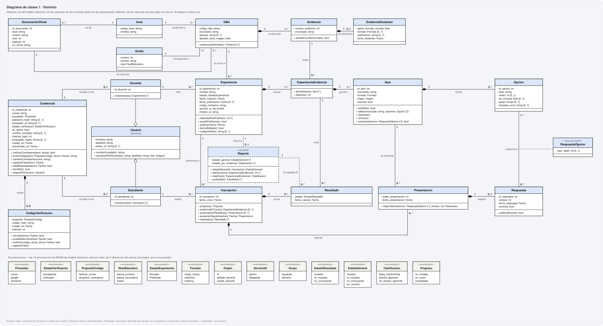
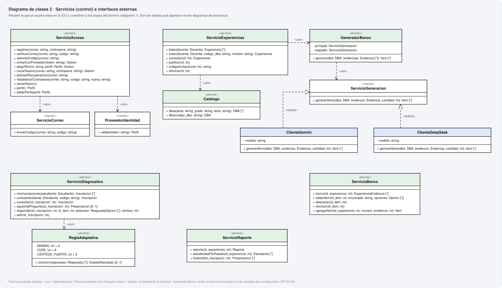

# 13. Diagrama de clases

**Metodología:** MODESEC — Fase III, Diseño Computacional, cuarta sub-etapa.
**Fecha:** 2026-10-21. **Archivo generado** por `uml/generar_uml.py`; no se edita a mano.

MODESEC: los diagramas de clases *«se utilizan para modelar la vista de diseño estático de
un sistema»*, *«resultan de la composición de los casos de uso»* y deben expresar *«detalles
de los objetos que existen en el área de enfoque»*, con *«atributos y métodos de cada una de
las clases»*. Las dos mitades de cada clase tienen, por eso, una fuente cada una:

- **Atributos:** los del modelo relacional (`17-modelo-relacional.md`) **menos las columnas
  de llave foránea**: en un modelo de objetos, esas columnas son las asociaciones. Llevan
  los mismos nombres del MER y del MR, a propósito: un dato no cambia de nombre entre
  documentos.
- **Métodos:** cada uno sale de uno o más casos de uso de `12-casos-de-uso.md`, y lo dice.
  Todo caso de uso aporta al menos un método.

Dos diagramas: el **dominio** (21 clases, 13 enumeraciones, 25 asociaciones) y los **servicios** (13 clases de control e interfaces), que son los objetos que aparecen en los diagramas de secuencia.

## 1. Decisiones de diseño

| Decisión | Por qué |
|---|---|
| **Usuario**, abstracta, generaliza a Docente y Estudiante | Tienen los mismos datos de perfil y la misma edición (CU-09). Es abstracta porque no hay usuarios sin rol, y en la base no tiene tabla: Docente y Estudiante son tipos separados (RF-01-06), cada uno con la suya. |
| **RespuestaOpcion** es clase asociación de «selecciona» | Una respuesta elige varias opciones, y en emparejar y ordenar cada elección lleva un valor (`valor_dado`). Es la entidad asociativa del MER. |
| **Reporte** es «calculada» | No persiste (ADR-022): sus atributos son derivados (`/`) y sus asociaciones también. |
| La regla adaptativa vive en **ReglaAdaptativa**, no en Resultado | Un resultado es una fotografía (RNF-11): no se recalcula a sí mismo. Quien decide es un servicio, y el resultado guarda lo que decidió. |
| `servicio_ia` y `modelo_ia` son de **Experiencia**, no de Item | Un banco sale entero de un solo servicio (RF-03-02): guardarlo en cada ítem lo repetía y dejaba que un banco mezclara servicios. El servicio de un ítem generado o editado es el de su experiencia (RF-03-03, RI-17). |
| **Usuario** existe aquí y no en el MER | Es una abstracción de diseño de objetos: agrupa lo que Docente y Estudiante hacen igual. En el MER y en la base siguen siendo dos entidades separadas, por la decisión del equipo de que la estructura impida asignar un estudiante como creador (ver `16`, «El MER y el diagrama de clases»). |
| **GeneradorBanco** depende de la interfaz **ServicioGeneracion** | Gemini y DeepSeek la realizan; cuál es el principal y cuál el respaldo es configuración (RF-03-02, ADR-030), no código. |

## 2. Diagrama 1 · Dominio

## 3. Diagrama 2 · Servicios

## 4. Clases del dominio

### Credencial

*Tabla `credencial` · entidad CREDENCIAL del MER.* La cuenta de acceso. Existe desde que la persona se registra, antes de tener rol. es_admin es la marca de la guía del docente para /users (ADR-040).

| Atributo | Tipo |
|---|---|
| `id_credencial` | int |
| `correo` | string |
| `proveedor` | Proveedor |
| `password_hash` | string [0..1] |
| `proveedor_id` | string [0..1] |
| `estado_verificacion` | EstadoVerificacion |
| `es_admin` | bool |
| `nombre_completo` | string [0..1] |
| `intentos_login` | int |
| `bloqueado_hasta` | Fecha [0..1] |
| `creado_en` | Fecha |
| `actualizado_en` | Fecha |

| Método | Casos de uso |
|---|---|
| `verificarContrasena(texto: string): bool` | CU-06 |
| `emitirCodigo(para: PropositoCodigo, ahora: Fecha): string` | CU-01, CU-03, CU-07 |
| `cambiarContrasena(nueva: string)` | CU-07 |
| `registrarFallo(ahora: Fecha)` | CU-06 |
| `estaBloqueada(ahora: Fecha): bool` | CU-06 |
| `tieneRol(): bool` | CU-02, CU-06 |
| `asignarRol(usuario: Usuario)` | CU-05 |

### CodigoVerificacion

*Tabla `codigo_verificacion` · entidad CODIGO_VERIFICACION del MER.* El código de 6 dígitos, con hash. A lo sumo uno por credencial y propósito (ADR-039).

| Atributo | Tipo |
|---|---|
| `proposito` | PropositoCodigo |
| `codigo_hash` | string |
| `creado_en` | Fecha |
| `intentos` | int |

| Método | Casos de uso |
|---|---|
| `vencido(ahora: Fecha): bool` | CU-03, CU-07 |
| `puedeReenviar(ahora: Fecha): bool` | CU-03 |
| `verificar(codigo: string, ahora: Fecha): bool` | CU-03, CU-07 |
| `registrarFallo()` | CU-03, CU-07 |

### Usuario {abstracta}

*Sin tabla.* Lo que Docente y Estudiante tienen igual. Abstracta: no hay usuarios sin rol, y en la base no tiene tabla (cada subclase tiene la suya: RF-01-06).

| Atributo | Tipo |
|---|---|
| `nombres` | string |
| `apellidos` | string |
| `avatar_url` | string [0..1] |

| Método | Casos de uso |
|---|---|
| `nombreCompleto(): string` | CU-09, CU-28 |
| `actualizarPerfil(nombres: string, apellidos: string, foto: Imagen)` | CU-05, CU-09 |

### Docente

*Tabla `docente` · entidad DOCENTE del MER.* Hereda de Usuario.

| Atributo | Tipo |
|---|---|
| `id_docente` | int |

| Método | Casos de uso |
|---|---|
| `experiencias(): Experiencia [*]` | CU-10 |

### Estudiante

*Tabla `estudiante` · entidad ESTUDIANTE del MER.* Hereda de Usuario. Solo los datos mínimos (ADR-029).

| Atributo | Tipo |
|---|---|
| `id_estudiante` | int |

| Método | Casos de uso |
|---|---|
| `inscripciones(): Inscripcion [*]` | CU-21 |

### Area

*Tabla `area` · entidad AREA del MER.* Catálogo (ADR-036): MAT, LEN, CN o CS. De solo lectura.

| Atributo | Tipo |
|---|---|
| `codigo_area` | string |
| `nombre` | string |

### Grado

*Tabla `grado` · entidad GRADO del MER.* Catálogo (ADR-036): 1° a 11°, con su nivel de la Ley 115. De solo lectura.

| Atributo | Tipo |
|---|---|
| `numero` | int |
| `nombre` | string |
| `nivel` | NivelEducativo |

### DocumentoOficial

*Tabla `documento_oficial` · entidad DOCUMENTO_OFICIAL del MER.* El PDF del MEN del que se copiaron los DBA de un área (ADR-036, ADR-033).

| Atributo | Tipo |
|---|---|
| `id_documento` | int |
| `titulo` | string |
| `version` | string |
| `anio` | int |
| `paginas` | int |
| `url_oficial` | string |

### DBA

*Tabla `dba` · entidad DBA del MER.* Dato del MEN, de solo lectura. Su área y su grado son asociaciones (ADR-036); codigo_dba tiene el formato ÁREA-GG-NN (RI-21).

| Atributo | Tipo |
|---|---|
| `codigo_dba` | string |
| `enunciado` | string |
| `ejemplo` | string [0..1] |
| `ejemplo_tiene_imagen` | bool |

| Método | Casos de uso |
|---|---|
| `evidenciasAdmitidas(): Evidencia [*]` | CU-16, CU-31 |

### Evidencia

*Tabla `evidencia` · entidad EVIDENCIA del MER.* Parte de su DBA (composición): sin él no tiene identidad.

| Atributo | Tipo |
|---|---|
| `numero_evidencia` | int |
| `enunciado` | string |

| Método | Casos de uso |
|---|---|
| `admiteFormatoCerrado(): bool` | CU-16, CU-31 |

### EvidenciaDictamen

*Tabla `evidencia_dictamen` · entidad EVIDENCIA_DICTAMEN del MER.* Nuestro juicio sobre una evidencia del MEN, separado del dato oficial (H-6).

| Atributo | Tipo |
|---|---|
| `aplica_formato_cerrado` | bool |
| `formato` | Formato [0..1] |
| `justificacion` | string [0..1] |
| `fecha_dictamen` | Fecha |

### Experiencia

*Tabla `experiencia` · entidad EXPERIENCIA del MER.* 

| Atributo | Tipo |
|---|---|
| `id_experiencia` | int |
| `nombre` | string |
| `estado` | EstadoExperiencia |
| `fecha_creacion` | Fecha |
| `fecha_publicacion` | Fecha [0..1] |
| `codigo_invitacion` | string |
| `servicio_ia` | ServicioIA |
| `modelo_ia` | string |

| Método | Casos de uso |
|---|---|
| `faltantesParaPublicar(): int [*]` | CU-13, CU-17 |
| `puedePublicarse(): bool` | CU-13 |
| `publicar(ahora: Fecha)` | CU-13 |
| `bancoEditable(): bool` | CU-17, CU-18, CU-19, CU-20 |
| `codigoVisible(): string [0..1]` | CU-14 |

### ExperienciaEvidencia

*Tabla `experiencia_evidencia` · entidad EXPERIENCIA_EVIDENCIA del MER.* Una evidencia que esta experiencia diagnostica. Sin atributos propios: su identidad es el par (experiencia, evidencia).

| Método | Casos de uso |
|---|---|
| `itemsActivos(): Item [*]` | CU-17, CU-23 |
| `faltantes(): int` | CU-13, CU-17 |

### Item

*Tabla `item` · entidad ITEM del MER.* 

| Atributo | Tipo |
|---|---|
| `id_item` | int |
| `enunciado` | string |
| `formato` | Formato |
| `origen` | Origen |
| `excluido` | bool |

| Método | Casos de uso |
|---|---|
| `esValido(): bool` | CU-16, CU-18, CU-20 |
| `editar(enunciado: string, opciones: Opcion [*])` | CU-18 |
| `descartar()` | CU-19 |
| `reincluir()` | CU-19 |
| `evaluar(seleccion: RespuestaOpcion [*]): bool` | CU-24 |

### Opcion

*Tabla `opcion` · entidad OPCION del MER.* 

| Atributo | Tipo |
|---|---|
| `id_opcion` | int |
| `texto` | string |
| `orden` | int [0..1] |
| `es_correcta` | bool [0..1] |
| `grupo` | Grupo [0..1] |
| `hipotesis_error` | string [0..1] |

### Inscripcion

*Tabla `inscripcion` · entidad INSCRIPCION del MER.* 

| Atributo | Tipo |
|---|---|
| `id_inscripcion` | int |
| `fecha_union` | Fecha |

| Método | Casos de uso |
|---|---|
| `progreso(): Progreso` | CU-21, CU-23 |
| `evidenciaEnCurso(): ExperienciaEvidencia [0..1]` | CU-23 |
| `presentacionPendiente(): Presentacion [0..1]` | CU-23 |
| `presentarSiguiente(ahora: Fecha): Presentacion` | CU-23 |
| `resultados(): Resultado [*]` | CU-27, CU-28, CU-29, CU-30 |

### Presentacion

*Tabla `presentacion` · entidad PRESENTACION del MER.* Haber MOSTRADO un ítem, distinto de haberlo respondido (H-2, H-3).

| Atributo | Tipo |
|---|---|
| `orden_presentacion` | int |
| `fecha_presentacion` | Fecha |

| Método | Casos de uso |
|---|---|
| `responder(seleccion: RespuestaOpcion [*], certeza: int): Respuesta` | CU-24 |

### Respuesta

*Tabla `respuesta` · entidad RESPUESTA del MER.* 

| Atributo | Tipo |
|---|---|
| `id_respuesta` | int |
| `certeza` | int |
| `fecha_respuesta` | Fecha |
| `correcta` | bool |

| Método | Casos de uso |
|---|---|
| `esSenalFuerte(): bool` | CU-25 |

### RespuestaOpcion «clase asociación»

*Tabla `respuesta_opcion` · entidad RESPUESTA_OPCION del MER.* Clase asociación de «selecciona»: qué opción eligió y, en emparejar u ordenar, qué valor le dio.

| Atributo | Tipo |
|---|---|
| `valor_dado` | int [0..1] |

### Resultado

*Tabla `resultado` · entidad RESULTADO del MER.* Fotografía del momento en que se concluyó (RNF-11). Lo crea ServicioDiagnostico con lo que decide ReglaAdaptativa.

| Atributo | Tipo |
|---|---|
| `estado` | EstadoResultado |
| `fecha_calculo` | Fecha |

### Reporte «calculada»

*Sin tabla · entidad REPORTE del MER.* No persiste: se calcula sobre Resultado cada vez que se abre (ADR-022).

| Atributo | Tipo |
|---|---|
| `/estado_general` | EstadoGeneral [*] |
| `/estado_por_evidencia` | Clasificacion [*] |

| Método | Casos de uso |
|---|---|
| `estadoGeneral(i: Inscripcion): EstadoGeneral` | CU-30 |
| `distribucion(e: ExperienciaEvidencia): int [*]` | CU-27 |
| `clasificar(e: ExperienciaEvidencia): Clasificacion` | CU-27 |
| `porEstado(): Estudiante [*]` | CU-28 |

## 5. Asociaciones

Cada una es una relación del MER, con su mismo nombre. El verificador exige que estén
todas y ninguna más.

| Clase A | Asociación | Clase B | Mult. A | Mult. B | Tipo |
|---|---|---|---|---|---|
| Credencial | *accede como* | Docente | 1 | 0..1 | asociacion |
| Credencial | *accede como* | Estudiante | 1 | 0..1 | asociacion |
| Credencial | *recibe* | CodigoVerificacion | 1 | 0..2 | composicion |
| DBA | *pertenece a* | Area | 1..* | 1 | asociacion |
| DBA | *corresponde a* | Grado | 1..* | 1 | asociacion |
| DBA | *se copia de* | DocumentoOficial | 1..* | 1 | asociacion |
| DocumentoOficial | *es de* | Area | 1..* | 1 | asociacion |
| DBA | *comprende* | Evidencia | 1 | 1..* | composicion |
| Evidencia | *se dictamina* | EvidenciaDictamen | 1 | 0..1 | composicion |
| Docente | *crea* | Experiencia | 1 | 0..* | asociacion |
| Experiencia | *se ancla a* | DBA | 0..* | 1 | asociacion |
| Experiencia | *incluye* | ExperienciaEvidencia | 1 | 1..* | composicion |
| Evidencia | *sobre* | ExperienciaEvidencia | 1 | 0..* | asociacion |
| ExperienciaEvidencia | *genera* | Item | 1 | 1..* | composicion |
| Item | *ofrece* | Opcion | 1 | 2..* | composicion |
| Estudiante | *realiza* | Inscripcion | 1 | 0..* | asociacion |
| Inscripcion | *pertenece a* | Experiencia | 0..* | 1 | asociacion |
| Inscripcion | *atiende* | Presentacion | 1 | 0..* | composicion |
| Item | *se presenta* | Presentacion | 1 | 0..* | asociacion |
| Presentacion | *registra* | Respuesta | 1 | 0..1 | composicion |
| Respuesta | *selecciona* | Opcion | 0..* | 1..* | asociacion |
| Inscripcion | *arroja* | Resultado | 1 | 0..* | composicion |
| ExperienciaEvidencia | *mide* | Resultado | 1 | 0..* | asociacion |
| Resultado | */se agrega en* | Reporte | 0..* | 1 | derivada |
| Reporte | */resume* | Experiencia | 0..1 | 1 | derivada |

Generalizaciones: Docente → Usuario; Estudiante → Usuario.

## 6. Enumeraciones

| Enumeración | Valores | Origen |
|---|---|---|
| Proveedor | correo, google, microsoft | ENUM de `credencial.proveedor` |
| EstadoVerificacion | procesando, verificado | ENUM de `credencial.estado_verificacion` |
| PropositoCodigo | verificar_correo, recuperar_contrasena | ENUM de `codigo_verificacion.proposito` |
| NivelEducativo | basica_primaria, basica_secundaria, media | ENUM de `grado.nivel` |
| EstadoExperiencia | Borrador, Publicada | ENUM de `experiencia.estado` |
| Formato | single_choice, matching, ordering | ENUM de `item.formato` |
| Origen | ia, editado_docente, creado_docente | ENUM de `item.origen` |
| ServicioIA | gemini, deepseek | ENUM de `experiencia.servicio_ia` |
| Grupo | izquierda, derecha | ENUM de `opcion.grupo` |
| EstadoResultado | muestra, no_muestra, no_concluyente | ENUM de `resultado.estado` |
| EstadoGeneral | muestra, no_muestra, no_concluyente, sin_concluir | valor calculado, no se guarda |
| Clasificacion | datos_insuficientes, brecha_aparente, sin_brecha_aparente | valor calculado, no se guarda |
| Progreso | no_iniciada, en_curso, completada | valor calculado, no se guarda |

## 7. Servicios e interfaces

### ServicioAcceso «servicio»

| Operación | Casos de uso |
|---|---|
| `registrar(correo: string, contrasena: string)` | CU-01 |
| `verificarCorreo(correo: string, codigo: string)` | CU-03 |
| `reenviarCodigo(correo: string)` | CU-03 |
| `entrarConProveedor(token: string): Sesion` | CU-02 |
| `elegirRol(rol: string, perfil: Perfil): Sesion` | CU-04, CU-05 |
| `iniciarSesion(correo: string, contrasena: string): Sesion` | CU-06 |
| `solicitarRecuperacion(correo: string)` | CU-07 |
| `restablecerContrasena(correo: string, codigo: string, nueva: string)` | CU-07 |
| `cerrarSesion()` | CU-08 |
| `perfil(): Perfil` | CU-09 |
| `editarPerfil(perfil: Perfil)` | CU-09 |

### ServicioExperiencias «servicio»

| Operación | Casos de uso |
|---|---|
| `listar(docente: Docente): Experiencia [*]` | CU-10 |
| `crear(docente: Docente, codigo_dba: string, nombre: string): Experiencia` | CU-11 |
| `consultar(id: int): Experiencia` | CU-12, CU-13, CU-15 |
| `publicar(id: int)` | CU-13 |
| `codigoInvitacion(id: int): string` | CU-14 |
| `eliminar(id: int)` | CU-15 |

### Catalogo «servicio»

| Operación | Casos de uso |
|---|---|
| `dbas(codigo_area: string, numero_grado: int, texto: string): DBA [*]` | CU-31 |
| `dba(codigo_dba: string): DBA` | CU-11, CU-31 |
| `areas(): Area [*]` | CU-11, CU-31 |
| `grados(): Grado [*]` | CU-31 |

### GeneradorBanco «servicio»

Atributos: `principal: ServicioGeneracion`, `respaldo: ServicioGeneracion`.

| Operación | Casos de uso |
|---|---|
| `generar(dba: DBA, evidencias: Evidencia [*]): Item [*]` | CU-16 |

### ServicioGeneracion «interfaz»

| Operación | Casos de uso |
|---|---|
| `generarItems(dba: DBA, evidencia: Evidencia, cantidad: int): Item [*]` | CU-16 |

### ClienteGemini

Atributos: `modelo: string`.

| Operación | Casos de uso |
|---|---|
| `generarItems(dba: DBA, evidencia: Evidencia, cantidad: int): Item [*]` | CU-16 |

### ClienteDeepSeek

Atributos: `modelo: string`.

| Operación | Casos de uso |
|---|---|
| `generarItems(dba: DBA, evidencia: Evidencia, cantidad: int): Item [*]` | CU-16 |

### ServicioBanco «servicio»

| Operación | Casos de uso |
|---|---|
| `banco(id_experiencia: int): ExperienciaEvidencia [*]` | CU-17 |
| `editarItem(id_item: int, enunciado: string, opciones: Opcion [*])` | CU-18 |
| `descartar(id_item: int)` | CU-19 |
| `reincluir(id_item: int)` | CU-19 |
| `agregarItem(id_experiencia: int, numero_evidencia: int): Item` | CU-20 |

### ServicioDiagnostico «servicio»

| Operación | Casos de uso |
|---|---|
| `misInscripciones(estudiante: Estudiante): Inscripcion [*]` | CU-21 |
| `unirse(estudiante: Estudiante, codigo: string): Inscripcion` | CU-22 |
| `consultar(id_inscripcion: int): Inscripcion` | CU-23, CU-26 |
| `siguientePregunta(id_inscripcion: int): Presentacion [0..1]` | CU-23 |
| `responder(id_inscripcion: int, id_item: int, seleccion: RespuestaOpcion [*], certeza: int)` | CU-24 |
| `salir(id_inscripcion: int)` | CU-26 |

### ReglaAdaptativa «servicio»

Atributos: `MINIMO: int = 4`, `TOPE: int = 6`, `CERTEZA_FUERTE: int = 3`.

| Operación | Casos de uso |
|---|---|
| `concluir(respuestas: Respuesta [*]): EstadoResultado [0..1]` | CU-25 |

### ServicioReporte «servicio»

| Operación | Casos de uso |
|---|---|
| `reporte(id_experiencia: int): Reporte` | CU-27 |
| `estudiantesPorEstado(id_experiencia: int): Estudiante [*]` | CU-28 |
| `historial(id_inscripcion: int): Presentacion [*]` | CU-29 |

### ServicioCorreo «interfaz»

| Operación | Casos de uso |
|---|---|
| `enviarCodigo(correo: string, codigo: string)` | CU-03, CU-07 |

### ProveedorIdentidad «interfaz»

| Operación | Casos de uso |
|---|---|
| `validar(token: string): Perfil` | CU-02 |

Dependencias: ServicioAcceso «usa» ServicioCorreo; ServicioAcceso «usa» ProveedorIdentidad; ServicioExperiencias «usa» Catalogo; ServicioExperiencias «usa» GeneradorBanco; GeneradorBanco «usa» ServicioGeneracion; ClienteGemini «realiza» ServicioGeneracion; ClienteDeepSeek «realiza» ServicioGeneracion; ServicioDiagnostico «usa» ReglaAdaptativa.

## 8. Verificación

`python uml/_verificar_uml.py`, bloque B: los atributos de cada clase son exactamente las
columnas de su tabla sin las de llave foránea; cada tabla del MR tiene su clase; cada
enumeración es el ENUM de su columna, valor por valor; las asociaciones son las relaciones
del MER con las mismas entidades; y todo caso de uso aporta al menos un método. El bloque E
comprueba que toda operación que un diagrama de secuencia invoca esté declarada aquí.

