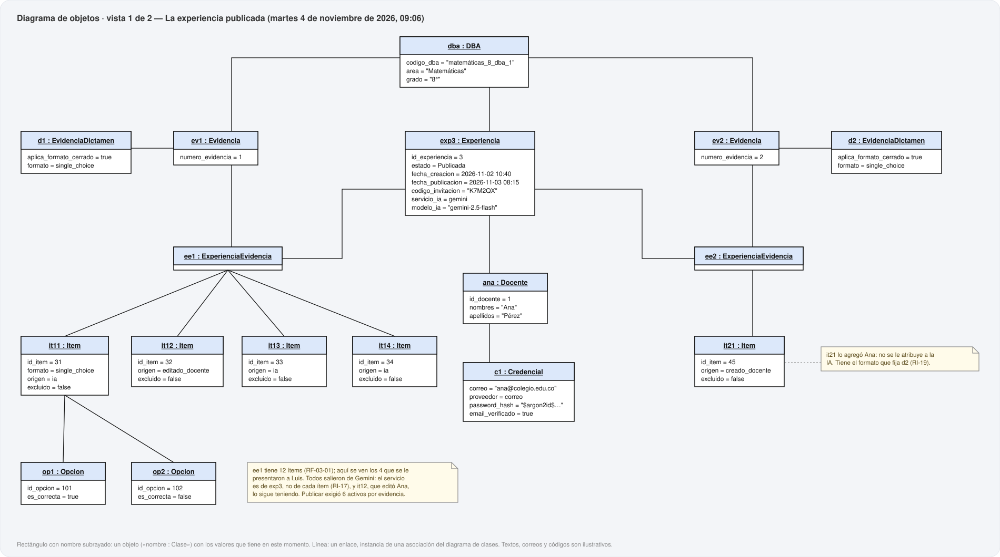
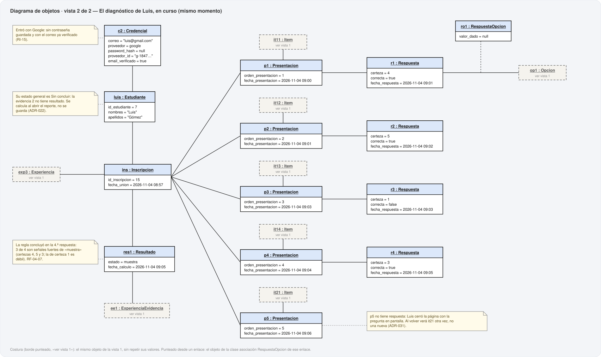

# 14. Diagrama de objetos

**Metodología:** MODESEC — Fase III, Diseño Computacional, quinta sub-etapa.
**Fecha:** 2026-10-21. **Archivo generado** por `uml/generar_uml.py`; no se edita a mano.

MODESEC: *«Un diagrama de objetos es un diagrama que representa un conjunto de objetos y
sus relaciones en un momento concreto.»* El momento elegido es el que más reglas pone a
prueba a la vez:

> **Martes 4 de noviembre de 2026, 09:06.** Luis está respondiendo la experiencia que Ana
> publicó el día anterior. Ya concluyó la evidencia 1 —*Muestra*, en la 4.ª respuesta— y
> acaba de ver la primera pregunta de la evidencia 2, pero cerró la página sin responderla.

Se dibuja en **dos vistas del mismo momento**, como el MER: la experiencia publicada (lo
que hizo Ana) y el diagnóstico de Luis (lo que hizo Luis). Un objeto que la segunda vista
necesita se dibuja allí como costura, sin repetir sus valores.

## 1. Vista 1 · La experiencia publicada

## 2. Vista 2 · El diagnóstico de Luis, en curso

## 3. Qué regla se ve en cada parte

| Lo que muestra | Regla |
|---|---|
| `c1` tiene contraseña cifrada; `c2`, que entró con Google, no tiene contraseña, sí identificador del proveedor, y el correo verificado. | RI-15 · RF-01-02 |
| Cada credencial da acceso a un solo rol. | RI-12 |
| `exp3` está Publicada y tiene fecha de publicación; Luis se unió después. | RI-16 · RI-7 |
| Las dos evidencias del DBA tienen dictamen que admite formato cerrado, y por eso las dos están incluidas. | RI-5 · RF-06-02 |
| El servicio y el modelo de IA están en `exp3`, no en cada ítem: un banco sale entero de un solo servicio. `it12`, que editó Ana, sigue siendo de Gemini; `it21`, que creó Ana, no se le atribuye a la IA. | RI-17 · RF-03-02 · RF-03-03 |
| Las dos evidencias incluidas son del DBA al que se ancla `exp3`. | RI-18 (ciclo C1) |
| `d1` y `d2` fijan el formato `single_choice`, y los ítems de esas evidencias lo usan. | RI-19 · RF-03-01 |
| Las cinco presentaciones tienen órdenes 1 a 5, sin repetir, y cada ítem es de la experiencia de la inscripción. | RI-8 · RI-13 (ciclo C2) |
| `ro1` elige `op1`, que es una opción de `it11`: el ítem que se le presentó en `p1`. | RI-6 (ciclo C4) |
| Las preguntas de la evidencia 1 van antes que la de la evidencia 2. | ADR-024 |
| `p5` no tiene respuesta: es la que Luis verá al volver. | ADR-031 · RF-04-09 |
| `res1` dice *muestra*: con las certezas 4, 5, 1 y 3 (la tercera incorrecta), hay 3 señales fuertes de «muestra» en 4 respuestas. | RF-04-07 |
| No hay resultado de la evidencia 2: el estado general de Luis es *Sin concluir*, y no se guarda. | ADR-022 · RF-05-01 |

## 4. Los objetos

| Objeto | Clase | Valores en este momento |
|---|---|---|
| `ana` | Docente | `id_docente = 1`; `nombres = "Ana"`; `apellidos = "Pérez"` |
| `c1` | Credencial | `correo = "ana@colegio.edu.co"`; `proveedor = correo`; `password_hash = "$argon2id$…"`; `email_verificado = true` |
| `dba` | DBA | `codigo_dba = "matemáticas_8_dba_1"`; `area = "Matemáticas"`; `grado = "8°"` |
| `ev1` | Evidencia | `numero_evidencia = 1` |
| `ev2` | Evidencia | `numero_evidencia = 2` |
| `d1` | EvidenciaDictamen | `aplica_formato_cerrado = true`; `formato = single_choice` |
| `d2` | EvidenciaDictamen | `aplica_formato_cerrado = true`; `formato = single_choice` |
| `exp3` | Experiencia | `id_experiencia = 3`; `estado = Publicada`; `fecha_creacion = 2026-11-02 10:40`; `fecha_publicacion = 2026-11-03 08:15`; `codigo_invitacion = "K7M2QX"`; `servicio_ia = gemini`; `modelo_ia = "gemini-2.5-flash"` |
| `ee1` | ExperienciaEvidencia | — (sin atributos propios) |
| `ee2` | ExperienciaEvidencia | — (sin atributos propios) |
| `it11` | Item | `id_item = 31`; `formato = single_choice`; `origen = ia`; `excluido = false` |
| `it12` | Item | `id_item = 32`; `origen = editado_docente`; `excluido = false` |
| `it13` | Item | `id_item = 33`; `origen = ia`; `excluido = false` |
| `it14` | Item | `id_item = 34`; `origen = ia`; `excluido = false` |
| `it21` | Item | `id_item = 45`; `origen = creado_docente`; `excluido = false` |
| `op1` | Opcion | `id_opcion = 101`; `es_correcta = true` |
| `op2` | Opcion | `id_opcion = 102`; `es_correcta = false` |
| `luis` | Estudiante | `id_estudiante = 7`; `nombres = "Luis"`; `apellidos = "Gómez"` |
| `c2` | Credencial | `correo = "luis@gmail.com"`; `proveedor = google`; `password_hash = null`; `proveedor_id = "g-1847…"`; `email_verificado = true` |
| `ins` | Inscripcion | `id_inscripcion = 15`; `fecha_union = 2026-11-04 08:57` |
| `p1` | Presentacion | `orden_presentacion = 1`; `fecha_presentacion = 2026-11-04 09:00` |
| `p2` | Presentacion | `orden_presentacion = 2`; `fecha_presentacion = 2026-11-04 09:01` |
| `p3` | Presentacion | `orden_presentacion = 3`; `fecha_presentacion = 2026-11-04 09:03` |
| `p4` | Presentacion | `orden_presentacion = 4`; `fecha_presentacion = 2026-11-04 09:04` |
| `p5` | Presentacion | `orden_presentacion = 5`; `fecha_presentacion = 2026-11-04 09:06` |
| `r1` | Respuesta | `certeza = 4`; `correcta = true`; `fecha_respuesta = 2026-11-04 09:01` |
| `r2` | Respuesta | `certeza = 5`; `correcta = true`; `fecha_respuesta = 2026-11-04 09:02` |
| `r3` | Respuesta | `certeza = 1`; `correcta = false`; `fecha_respuesta = 2026-11-04 09:03` |
| `r4` | Respuesta | `certeza = 3`; `correcta = true`; `fecha_respuesta = 2026-11-04 09:05` |
| `ro1` | RespuestaOpcion | `valor_dado = null` |
| `res1` | Resultado | `estado = muestra`; `fecha_calculo = 2026-11-04 09:05` |

Nombres, correos, códigos y el modelo de IA son **ilustrativos**. Lo que no es ilustrativo
es la estructura y que cada valor cumpla las reglas.

## 5. Verificación: la fotografía se carga en el esquema real

`python uml/_verificar_uml.py`, bloques C y D. Además de comprobar que cada atributo exista
en su clase y cada enlace sea una asociación del diagrama de clases, el verificador **carga
los objetos en `modelo-relacional/mr_esquema.sql`**: convierte cada objeto en una fila y cada
enlace en su llave foránea, y los inserta. Si la fotografía violara una sola restricción
—un ítem de otra experiencia, una credencial de Google con contraseña, un orden repetido—
el motor la rechazaría. Y recalcula el resultado de la evidencia 1 con la regla de RF-04-07
(`uml/regla.py`): tiene que dar *muestra* en la 4.ª respuesta, que es lo que dice `res1`.

