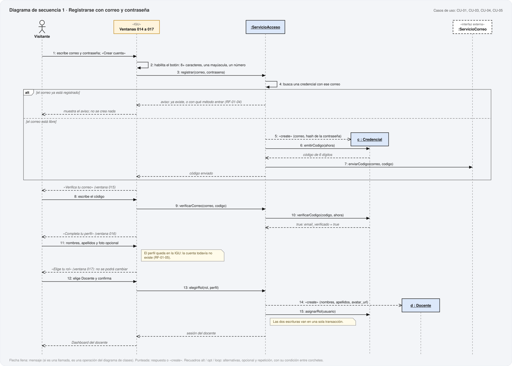
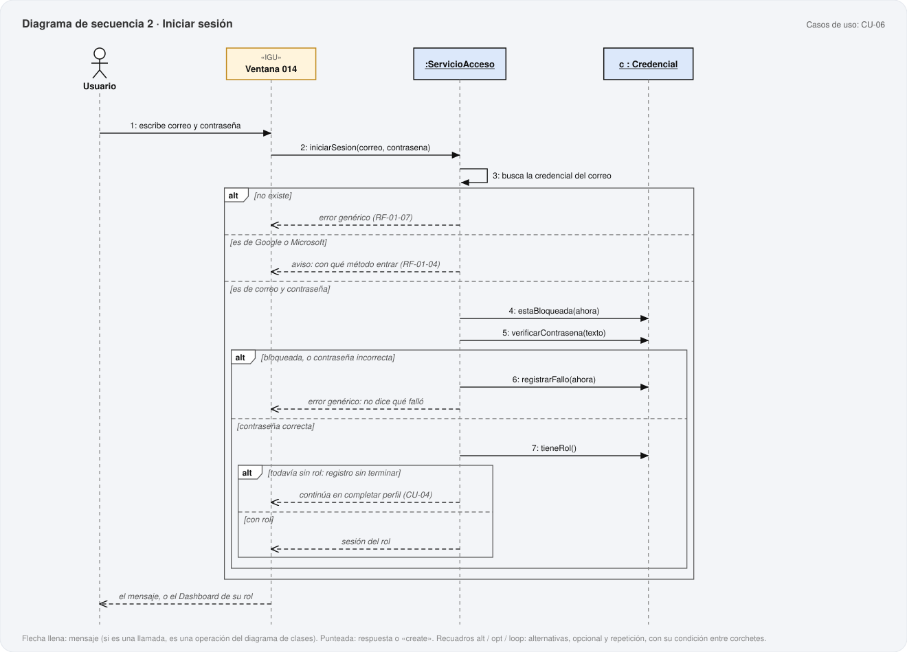
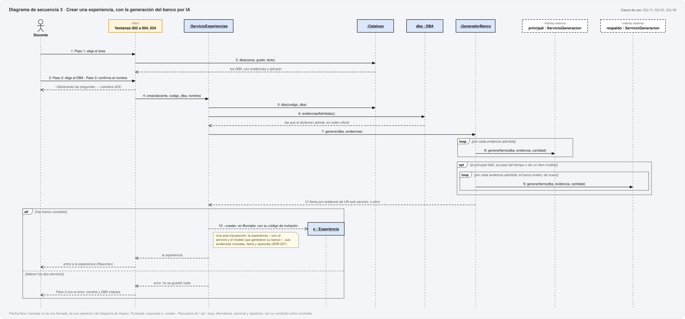
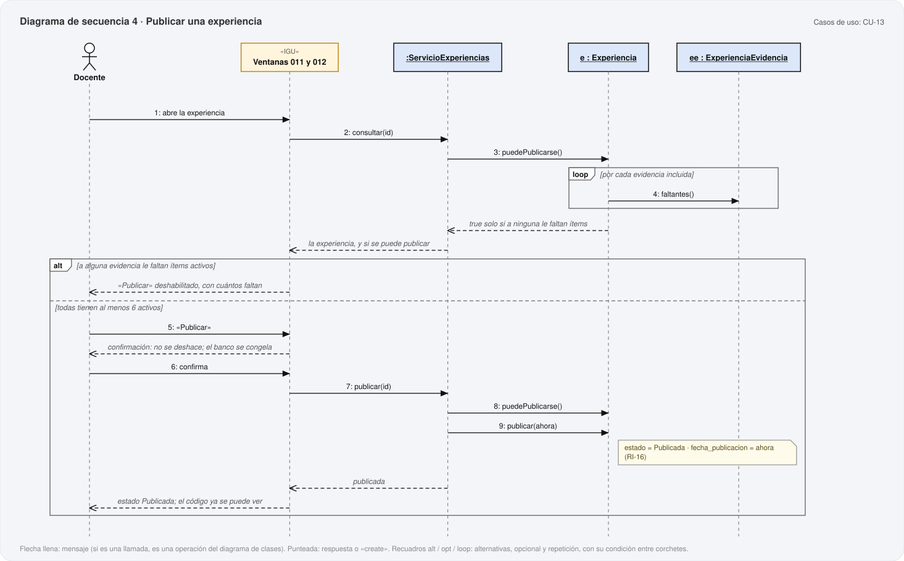
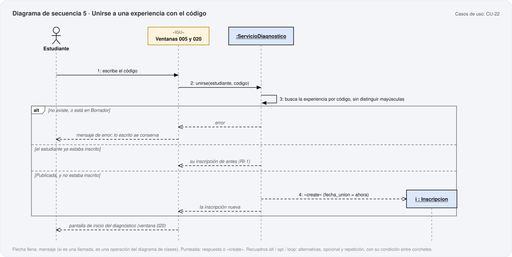
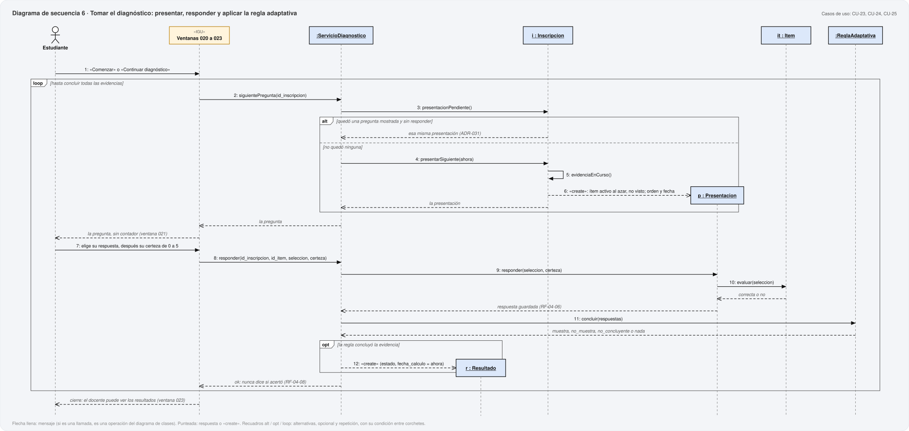
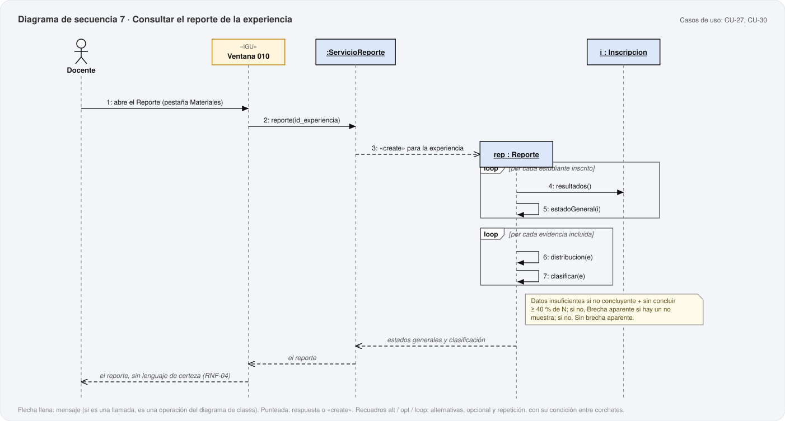
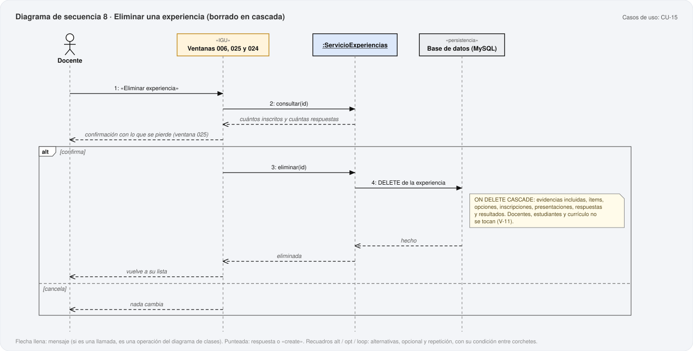

# 15. Diagramas de secuencia

**Metodología:** MODESEC — Fase III, Diseño Computacional, sexta sub-etapa.
**Fecha:** 2026-10-21. **Archivo generado** por `uml/generar_uml.py`; no se edita a mano.

MODESEC: *«Los Diagramas de Secuencia representan una interacción entre objetos de manera
secuencial en el tiempo […] El responsable o actor es quien inicia el ciclo interactuando
inicialmente con la interfaz de usuario (IGU); en seguida se inician todos los objetos que
intervienen en el funcionamiento del aplicativo.»* Cada diagrama, por eso, empieza en un
actor, pasa por la IGU —la ventana de la Fase II que corresponde— y de ahí a los servicios y
a las clases del dominio de `13-diagrama-clases.md`.

**8 diagramas**, elegidos por ser los flujos con más decisiones: los que
tienen ramas, repeticiones o reglas que el código tendrá que respetar al pie de la letra.

| # | Diagrama | Casos de uso | Ventanas |
|---|---|---|---|
| 1 | Registrarse con correo y contraseña | CU-01, CU-03, CU-04, CU-05 | 014, 015, 016, 017 |
| 2 | Iniciar sesión | CU-06 | 014 |
| 3 | Crear una experiencia, con la generación del banco por IA | CU-11, CU-31, CU-16 | 002, 003, 004, 024 |
| 4 | Publicar una experiencia | CU-13 | 011, 012 |
| 5 | Unirse a una experiencia con el código | CU-22 | 005, 020 |
| 6 | Tomar el diagnóstico: presentar, responder y aplicar la regla adaptativa | CU-23, CU-24, CU-25 | 020, 021, 022, 023 |
| 7 | Consultar el reporte de la experiencia | CU-27, CU-30 | 010 |
| 8 | Eliminar una experiencia (borrado en cascada) | CU-15 | 006, 025, 024 |

**Cómo leerlos.** Flecha llena: un mensaje; si está escrito como llamada —`publicar(id)`—
es una operación declarada en el diagrama de clases, y el verificador lo comprueba. Flecha
punteada: una respuesta, o «create» (el objeto nace ahí: su cabecera aparece a esa altura).
Recuadros **alt** (alternativas), **opt** (opcional) y **loop** (repetición), con su condición
entre corchetes.

## 1. Registrarse con correo y contraseña

Por qué la cuenta con rol se crea al final: entre «Crear cuenta» y «Elegir rol» solo existe la credencial —hace falta para guardar el código de verificación— y el perfil viaja en la IGU hasta que se elige el rol (RF-01-05). Docente y credencial se escriben juntos. El «alt» del principio es RF-01-04: con un correo ya registrado no se crea nada.

Operaciones del diagrama de clases que usa: `ServicioAcceso.registrar()`, `Credencial.emitirCodigo()`, `ServicioCorreo.enviarCodigo()`, `ServicioAcceso.verificarCorreo()`, `CodigoVerificacion.verificar()`, `ServicioAcceso.elegirRol()`, `Credencial.asignarRol()`.

## 2. Iniciar sesión

Los caminos de un inicio de sesión que no termina en el Dashboard: el correo no existe (mensaje genérico), es de una cuenta de Google o Microsoft (aviso del método), o la contraseña falla o la cuenta está bloqueada (se cuenta el intento). Una credencial sin rol retoma el registro: es la decisión del alterno 3a de CU-06.

Operaciones del diagrama de clases que usa: `ServicioAcceso.iniciarSesion()`, `Credencial.estaBloqueada()`, `Credencial.verificarContrasena()`, `Credencial.registrarFallo()`, `Credencial.tieneRol()`.

## 3. Crear una experiencia, con la generación del banco por IA

La creación «todo o nada» de ADR-027. El banco se pide al servicio principal; si falla, se pasa del tiempo o entrega un ítem inválido, el de respaldo lo genera completo de nuevo, así que un banco nunca mezcla servicios (RF-03-02). Solo si hay banco se crea la experiencia, en una sola transacción con todo lo que depende de ella; si fallan los dos, no se guardó nada.

Operaciones del diagrama de clases que usa: `Catalogo.dbas()`, `ServicioExperiencias.crear()`, `Catalogo.dba()`, `DBA.evidenciasAdmitidas()`, `GeneradorBanco.generar()`, `ServicioGeneracion.generarItems()`.

## 4. Publicar una experiencia

Publicar se comprueba dos veces: al mostrar el botón —para deshabilitarlo y decir cuántos ítems faltan— y otra vez al confirmar, porque entre una cosa y otra el docente pudo descartar ítems. Estado y fecha de publicación cambian juntos, que es lo que exige RI-16.

Operaciones del diagrama de clases que usa: `ServicioExperiencias.consultar()`, `Experiencia.puedePublicarse()`, `ExperienciaEvidencia.faltantes()`, `ServicioExperiencias.publicar()`, `Experiencia.publicar()`.

## 5. Unirse a una experiencia con el código

Las tres respuestas posibles a un código: error (no existe, o la experiencia está en Borrador: RI-7), la inscripción de antes (RI-1: unirse dos veces no duplica), o una inscripción nueva.

Operaciones del diagrama de clases que usa: `ServicioDiagnostico.unirse()`.

## 6. Tomar el diagnóstico: presentar, responder y aplicar la regla adaptativa

El centro del diagnóstico. Cada vuelta presenta una pregunta y registra su respuesta. Lo primero es preguntar si quedó una presentación sin responder: si la hay, se repite esa (ADR-031) y no se crea otra. La regla adaptativa decide después de cada respuesta y, cuando concluye, el resultado se guarda como fotografía (RNF-11). Nada de lo que vuelve a la IGU dice si el estudiante acertó.

Operaciones del diagrama de clases que usa: `ServicioDiagnostico.siguientePregunta()`, `Inscripcion.presentacionPendiente()`, `Inscripcion.presentarSiguiente()`, `Inscripcion.evidenciaEnCurso()`, `ServicioDiagnostico.responder()`, `Presentacion.responder()`, `Item.evaluar()`, `ReglaAdaptativa.concluir()`.

## 7. Consultar el reporte de la experiencia

El reporte no se guarda: se arma cada vez con los resultados de cada inscrito (ADR-022). El estado general de cada estudiante y la clasificación de cada evidencia salen de RF-05-01 y RF-05-02, con umbrales que fija el sistema.

Operaciones del diagrama de clases que usa: `ServicioReporte.reporte()`, `Inscripcion.resultados()`, `Reporte.estadoGeneral()`, `Reporte.distribucion()`, `Reporte.clasificar()`.

## 8. Eliminar una experiencia (borrado en cascada)

Cómo se cierra el vacío V-11: el servicio solo borra la experiencia; las llaves foráneas con ON DELETE CASCADE del modelo relacional borran lo que depende de ella. Por eso la confirmación puede decir exactamente qué se pierde, y por eso las cuentas y el currículo no se tocan (RESTRICT).

Operaciones del diagrama de clases que usa: `ServicioExperiencias.consultar()`, `ServicioExperiencias.eliminar()`.

## Verificación

`python uml/_verificar_uml.py`, bloque E: toda llamada de estos diagramas es una operación
declarada en la clase de su receptor (heredadas incluidas), todo «create» es de una clase
que existe, y todo caso de uso y ventana citados existen.

