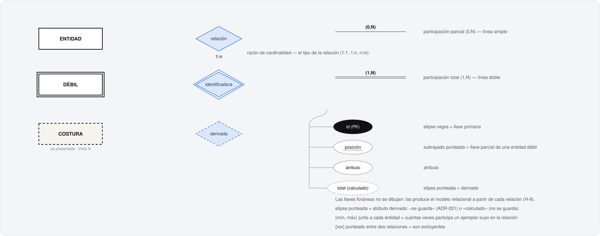
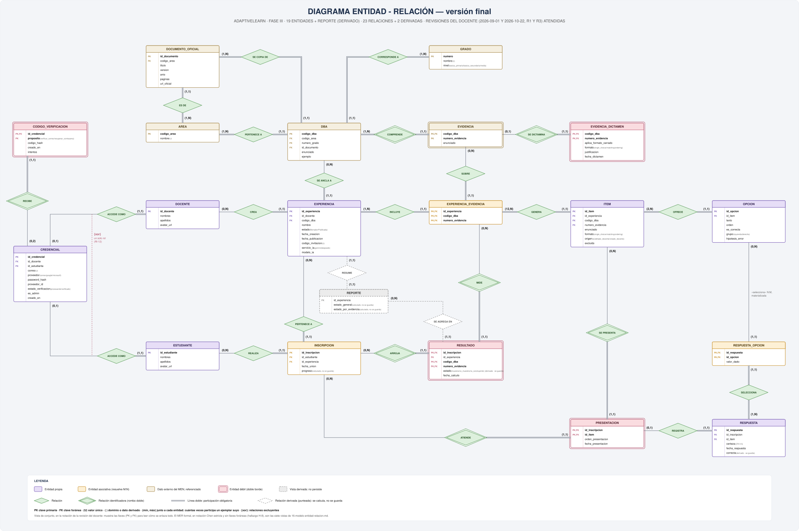
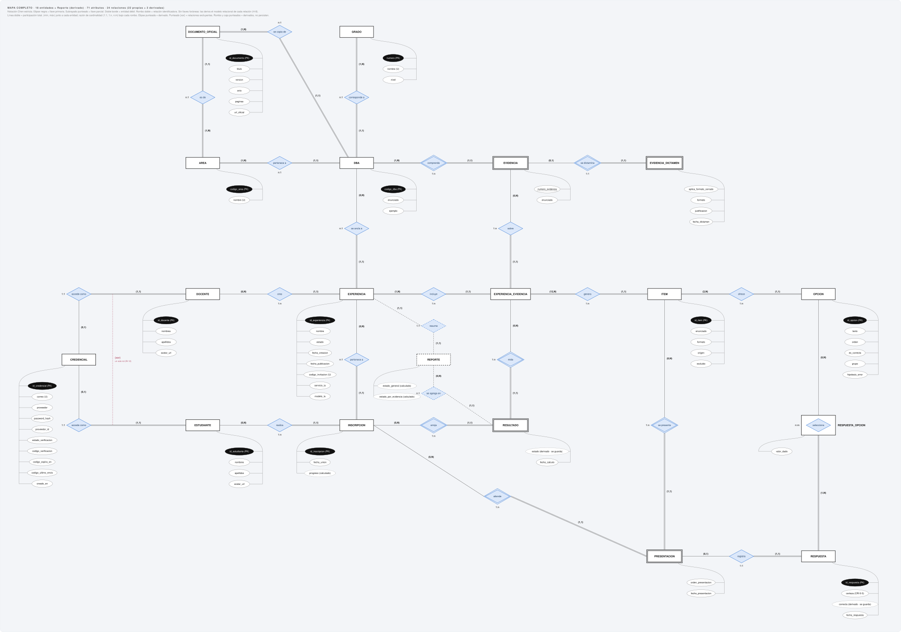
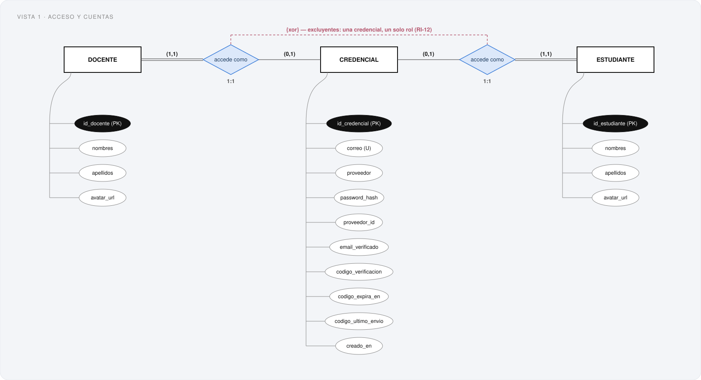
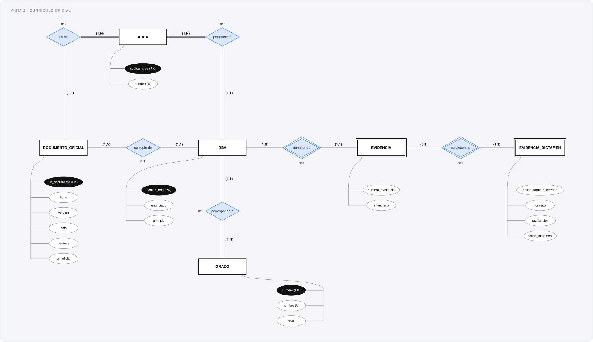
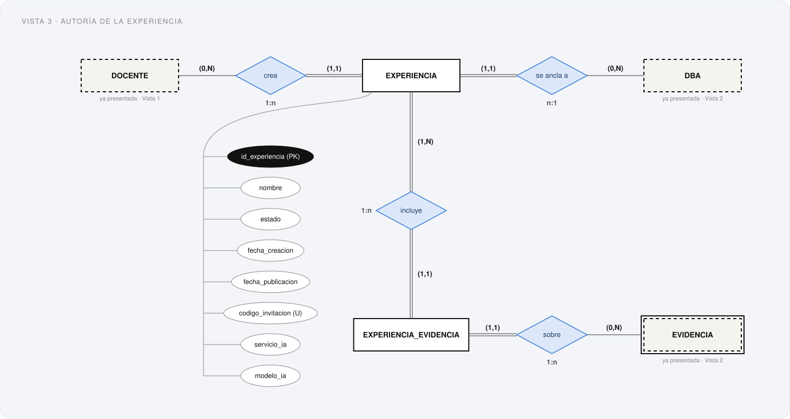
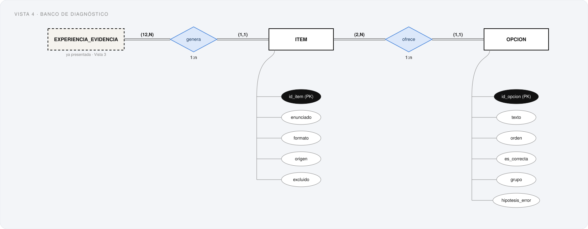
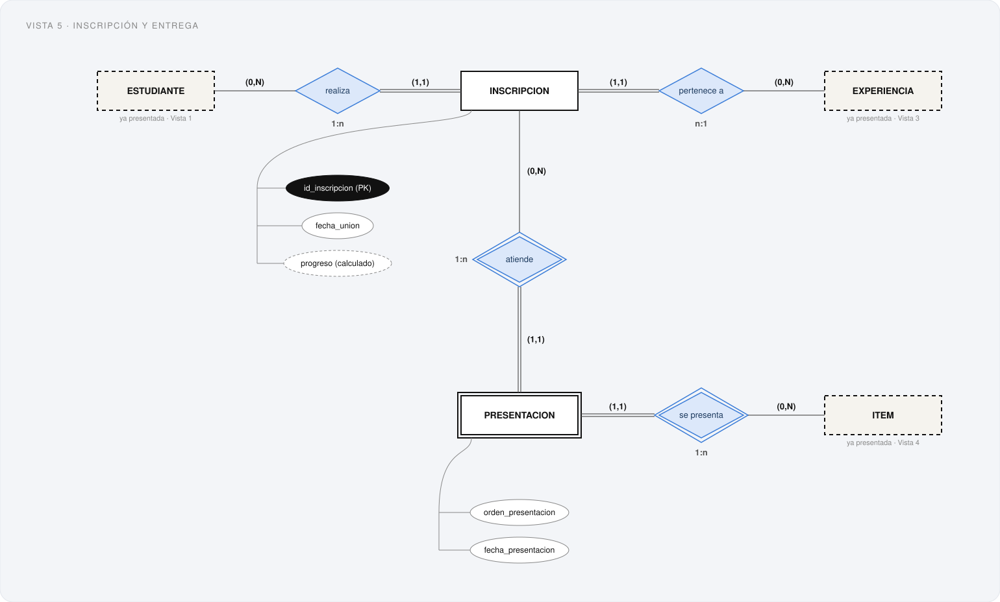
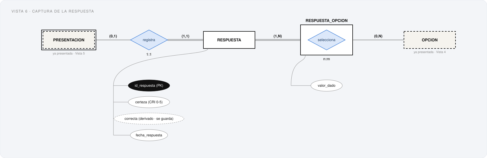
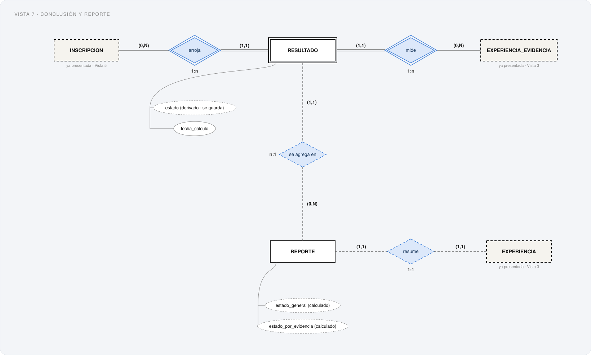

# 16. Modelo Entidad-Relación — AdaptiveLearn

**Metodología:** MODESEC — Fase III, Diseño Computacional, modelado de la base de datos.
**Fecha:** 2026-10-21. **Estado:** versión final de la Fase III. **Archivo generado** por
`mer/generar_documento.py` desde `mer/datos_mer.py`, la misma fuente de los diagramas; no se
edita a mano.

MODESEC: *«En esta etapa se recomienda la utilización de bases de datos relacionales […] Si
la opción es la primera, se deberá crear un MER (Modelo Entidad Relación), un MR (Modelo
relacional) basado en el MER y un diccionario de datos para los metadatos»*. Este documento
es el primero de los tres; el MR es `17-modelo-relacional.md` y el diccionario,
`18-diccionario-datos.md`.

**Este es el MER vigente del proyecto.** Parte de la *Quinta revisión* (2026-09-08), el
borrador que respondió a la revisión del docente del 2026-09-01 con la Fase II todavía
abierta, y lo lleva a lo que la Fase II cerrada y el análisis de requerimientos (`11`)
exigen. Para leerlo:

- **Qué hay:** las entidades (sección 4) y cómo se relacionan (5).
- **Cómo encaja todo:** los ciclos del modelo y la regla que cierra cada uno (6), quién crea,
  lee, modifica y borra cada entidad (7), y un recorrido de la cuenta al reporte (8).
- **Con el resto de la fase:** el diagrama de clases (9) y la revisión del docente, hallazgo
  por hallazgo (10).
- **Lo que el diagrama no puede decir:** las restricciones (11), los vacíos (12) y qué cambió
  respecto del borrador (13).

## 1. Conteo

| Entidades | Relaciones | Atributos | Ciclos | Restricciones de integridad | Vacíos abiertos |
|---|---|---|---|---|---|
| **15** (+ Reporte, derivado) | **18** (+ 2 derivadas) | **62** | **5**, todos cerrados | **19** | **2** (V-6, V-9) + 1 nuevo (V-12) |

## 2. Notación

**Chen estricta**, como decidió la Quinta revisión para cerrar el hallazgo H-8:

| Símbolo | Significa |
|---|---|
| Rectángulo · doble borde | Entidad · entidad débil |
| Rombo · rombo doble | Relación · relación identificadora |
| Elipse · elipse negra · subrayado punteado | Atributo · llave primaria · llave parcial de una débil |
| **Elipse punteada** | Atributo derivado: «se guarda» (ADR-021) o «calculado» (no se guarda) |
| Línea simple · **línea doble** | Participación parcial · total |
| **(mín, máx) junto a cada entidad** | Cuántas veces participa un ejemplar suyo en la relación — la notación de la tabla de la v3 del docente |
| Razón bajo el rombo (1:1, 1:n, n:m) | El tipo de la relación |
| **{xor} punteado entre dos relaciones** | Son excluyentes: un ejemplar participa en una o en la otra |
| Rombo y caja punteados | Derivados: se calculan, no persisten |

**Las llaves foráneas no se dibujan.** Es exactamente lo que señaló H-8: *«la FK es
precisamente lo que la derivación al MR produce a partir de la relación ya dibujada»*. Cada
entidad muestra solo sus atributos; las FK aparecen en `17-modelo-relacional.md`, y
`modelo-relacional/_verificar_mr_mer.py` comprueba que cada una salga de una relación de
este modelo, y que cada relación tenga la FK que la realiza.



## 3. Diagramas

La **vista de conjunto**, el **mapa completo** y las **siete vistas** no son tres modelos:
salen de `mer/datos_mer.py`. Las vistas se cortan por el ciclo de vida del sistema, y cada
relación se dibuja en **exactamente una** vista (lo comprueba `mer/_verificar_vistas.py`);
una entidad que reaparece en otra vista se dibuja como costura, sin atributos. La geometría
—líneas que atraviesan cajas, rótulos encimados— la revisan `mer/_verificar_mapa.py` y el
verificador de `mer/mapa_cajas.py`, por coordenadas.

### Vista de conjunto, con la estructura de la v3 del docente

El modelo entero en una sola lámina, con la estructura con que el docente presentó su
modelo v3: cajas de color por tipo de entidad, rombos verdes, línea doble para la
participación total, (mín, máx) en cada extremo y leyenda abajo. Para mirarlo de un vistazo
muestra también las llaves (PK y FK), calculadas del modelo relacional, así que no puede
contradecirlo. `mer/mer-pantalla-completa.html` la abre a pantalla completa, con zoom.



### Mapa completo, en Chen



### Vista 1 · Acceso y cuentas

Quién puede entrar, con qué credencial, y con cuál de los dos roles.



### Vista 2 · Currículo oficial

Qué nos entrega el MEN, y cuál es el único juicio nuestro sobre ese material.



### Vista 3 · Autoría de la experiencia

Quién crea una experiencia, a qué DBA la ancla, y qué evidencias de ese DBA diagnostica.



### Vista 4 · Banco de diagnóstico

El contenido que se genera, se edita o se agrega para cada evidencia incluida.



### Vista 5 · Inscripción y entrega

Quién entró a la experiencia, y qué ítem se le mostró en qué orden.



### Vista 6 · Captura de la respuesta

Qué respondió exactamente, y con cuánta certeza.



### Vista 7 · Conclusión y reporte

En qué se traduce todo lo anterior, por estudiante y por evidencia.



## 4. Entidades

### CREDENCIAL

**Tipo:** Propia. **Atributos:** `id_credencial` (PK), `correo` (U), `proveedor`, `password_hash`, `proveedor_id`, `email_verificado`, `codigo_verificacion`, `codigo_expira_en`, `codigo_ultimo_envio`, `creado_en`.

**Nueva en esta versión (cierra V-8).** La cuenta de acceso: con qué correo y qué método se entra, la verificación del correo y a qué rol da acceso. Existe desde «Crear cuenta», *antes* de que exista el docente o el estudiante: hace falta para guardar el código de verificación (RF-01-03), y el docente o el estudiante se crea recién al elegir el rol (RF-01-05, RF-01-06). El correo vive aquí y no en Docente/Estudiante: es el correo de la cuenta, y así su unicidad vale **entre los dos roles** (RF-01-04), cosa que dos UNIQUE separados no garantizan. Accede como docente **o** como estudiante, nunca como los dos ({xor}, RI-12). Es la tabla que el incremento I1 ya construyó (`backend/sql/001_esquema_auth.sql`).

*Fuente: Ventanas 014 a 019 · RF-01-01 a RF-01-09 · backend I1.*

### DOCENTE

**Tipo:** Propia. **Atributos:** `id_docente` (PK), `nombres`, `apellidos`, `avatar_url`.

Quien crea y publica experiencias. Separado de Estudiante como entidad propia (decisión del borrador, que se mantiene): la relación de cada uno con Experiencia es distinta —creador y miembro— y separarlos hace que la estructura impida asignar un estudiante como creador. **Cambia:** `nombre` pasa a `nombres` + `apellidos` y sale `correo`.

*Fuente: 04-spec-dashboard · 19-spec-auth-completa-perfil · 26-spec-modal-mi-perfil · RF-01-05, RF-01-11.*

### ESTUDIANTE

**Tipo:** Propia. **Atributos:** `id_estudiante` (PK), `nombres`, `apellidos`, `avatar_url`.

Quien se une con un código y responde el diagnóstico. Solo los datos mínimos (ADR-029): nombres, apellidos y foto opcional; el correo está en su credencial. Mismo cambio que Docente.

*Fuente: ADR-029 · RF-01-05 · RNF-05.*

### EXPERIENCIA

**Tipo:** Propia. **Atributos:** `id_experiencia` (PK), `nombre`, `estado`, `fecha_creacion`, `fecha_publicacion`, `codigo_invitacion` (U), `servicio_ia`, `modelo_ia`.

Un diagnóstico anclado a un único DBA, creado por un docente. Se guarda solo si su banco se generó completo (ADR-027). `estado`: Borrador o Publicada, sin vuelta atrás (ADR-026). `fecha_publicacion` es nula mientras esté en Borrador (RI-16). `codigo_invitacion` se genera al crearla y se muestra solo publicada (RF-02-06). **`servicio_ia` y `modelo_ia`** dicen con qué servicio y modelo se generó su banco: un banco sale entero de un solo servicio (RF-03-02), así que es un dato de la experiencia y no de cada ítem (RI-17). Área y grado no son atributos: se derivan del DBA.

*Fuente: 07-spec-crear-experiencia-paso3 · 15-spec-modal-confirmar-publicar · 08-spec-unirse-codigo · ADR-026, ADR-027, ADR-030 · RF-03-02, RF-03-03.*

### DBA

**Tipo:** Externa (MEN). **Atributos:** `codigo_dba` (PK), `area`, `grado`, `enunciado`, `ejemplo`.

Derecho Básico de Aprendizaje oficial del MEN: dato externo, referenciado, de solo lectura (SUB-06). `codigo_dba` es la llave natural del MEN, verificada contra `curriculo_men_normalizado.json` (`{área}_{grado}_dba_{número}`). `ejemplo` se usa como contexto al generar el banco (ADR-011) y todavía falta en la normalización (QA-011).

*Fuente: Glosario «DBA» · ADR-005, ADR-011 · RF-06-01.*

### EVIDENCIA

**Tipo:** Externa (MEN) · débil. **Atributos:** `numero_evidencia` (llave parcial), `enunciado`.

Evidencia de aprendizaje de un DBA. **Débil**: sin su DBA no tiene identidad. Se identifica por la llave de su DBA (relación identificadora *comprende*) más su **llave parcial** `numero_evidencia`: su posición en la lista del MEN, que es también el orden oficial en que se diagnostica (ADR-024). Dato del MEN, sin juicio nuestro.

*Fuente: Glosario «Evidencia» · curriculo_men_normalizado.json · ADR-024.*

### EVIDENCIA_DICTAMEN

**Tipo:** Débil. **Atributos:** `aplica_formato_cerrado`, `formato`, `justificacion`, `fecha_dictamen`.

Nuestro juicio sobre una evidencia del MEN: si admite formato cerrado y **cuál** (`formato`). Separada de Evidencia a propósito (hallazgo H-6 del docente) para no mezclar contenido oficial con criterio propio. `formato` entra en esta versión: «el formato de los ítems lo determina la evidencia» (RF-03-01) y una pregunta propia «se crea con el formato de esa evidencia» (RF-03-07), y antes no había dónde guardarlo (RI-19). Débil y 1:1 con su evidencia: la identifica la evidencia misma, así que no necesita llave parcial. Sus valores dependen del censo QA-014 (V-6, abierto).

*Fuente: H-6 · ADR-006 · RF-06-02 · RF-03-01 · RF-03-07.*

### EXPERIENCIA_EVIDENCIA

**Tipo:** Asociativa. **Atributos:** ninguno propio.

Las evidencias que diagnostica *esta* experiencia (hallazgo H-4 del docente). Hace que Ítem y Resultado cuelguen de un solo camino al currículo. **No tiene atributos propios**: su identidad es el par (experiencia, evidencia) que le dan sus dos relaciones, *incluye* y *sobre* — y la evidencia tiene que ser del DBA de la experiencia (RI-18, ciclo C1). **Cambia:** sale `incluida`. El docente no elige evidencias (QA-010) y solo entran las que el dictamen admite (RF-03-01): una fila de esta entidad **es** una evidencia incluida, y un booleano siempre verdadero no dice nada.

*Fuente: H-4 · QA-010 · RF-03-01.*

### INSCRIPCION

**Tipo:** Asociativa. **Atributos:** `id_inscripcion` (PK), `fecha_union`, `progreso` (calculado, no se guarda).

Un estudiante unido a una experiencia. Asociativa con llave propia, para que Presentación y Resultado no arrastren llave doble. De aquí sale el contador de estudiantes. **`progreso`** —No iniciada, En curso o Completada (RF-04-01)— va en elipse punteada: se calcula de sus presentaciones y resultados y no se guarda (ADR-022). Es lo que la v3 del docente llamaba `estado_avance`.

*Fuente: 08-spec-unirse-codigo · RF-04-01 · RF-04-02 · ADR-022.*

### ITEM

**Tipo:** Propia. **Atributos:** `id_item` (PK), `enunciado`, `formato`, `origen`, `excluido`.

Pregunta del banco. La IA genera 12 por evidencia incluida al crear la experiencia (RF-03-01); el docente puede editar, descartar (`excluido`) y agregar las suyas mientras esté en Borrador (ADR-026). Ninguno se borra, por eso *genera* es (12,N). **Cambia:** `origen` admite tres valores —`ia`, `editado_docente`, `creado_docente`—; el servicio y el modelo que lo generaron son los de su experiencia. `formato` es el que fija el dictamen de su evidencia (RI-19). **Sale `estado_revision`** (cierra V-7): tras ADR-026 revisar el banco no es requisito de nada y ningún requerimiento lo usa; lo que habilita a publicar es tener al menos 6 activos por evidencia (RF-02-05).

*Fuente: ADR-005, ADR-006, ADR-014, ADR-015, ADR-016, ADR-026, ADR-030 · RF-03-01 a RF-03-08.*

### OPCION

**Tipo:** Propia. **Atributos:** `id_opcion` (PK), `texto`, `orden`, `es_correcta`, `grupo`, `hipotesis_error`.

Opción de respuesta de un ítem. Qué columnas aplican depende del formato (RI-4). `hipotesis_error` existe pero nunca se muestra ni se reporta (ADR-008, ADR-020).

*Fuente: ADR-014 · ADR-020.*

### PRESENTACION

**Tipo:** Débil. **Atributos:** `orden_presentacion`, `fecha_presentacion`.

El hecho de **haber mostrado** un ítem a un estudiante, distinto del de haberlo respondido (hallazgos H-2 y H-3). Débil, sin llave parcial: la identifican a la vez la inscripción y el ítem (*atiende* y *se presenta*, las dos identificadoras), y el ítem tiene que ser de la experiencia de la inscripción (RI-13, ciclo C2). Una presentación sin respuesta es la pregunta que el estudiante verá otra vez al retomar (ADR-031). Con `orden_presentacion` y `fecha_presentacion` la secuencia adaptativa se puede reconstruir.

*Fuente: H-2, H-3 · ADR-016 · ADR-031 · RF-04-04.*

### RESPUESTA

**Tipo:** Propia. **Atributos:** `id_respuesta` (PK), `certeza`, `correcta` (derivado, se guarda), `fecha_respuesta`.

Lo que el estudiante respondió a un ítem que se le presentó, con su certeza (CRI, 0 a 5). Cuelga de Presentación, no de Ítem e Inscripción por separado: no hay respuesta sin presentación. `correcta` es derivado y **se guarda** al responder (ADR-021). **Pasa a propia** (antes figuraba como asociativa): desde H-3 cuelga de una sola entidad y no resuelve ninguna N:M — la asociativa de esta parte es Respuesta_Opción.

*Fuente: ADR-008, ADR-019, ADR-021 · RF-04-05, RF-04-06.*

### RESPUESTA_OPCION

**Tipo:** Asociativa. **Atributos:** `valor_dado`.

Qué opción u opciones eligió el estudiante, no solo si acertó; sin esto, emparejar y ordenar no son representables. `valor_dado`: la posición (ordenar) o el número de pareja (emparejar). La opción elegida tiene que ser del ítem que se presentó (RI-6, ciclo C4).

*Fuente: ADR-019.*

### RESULTADO

**Tipo:** Débil. **Atributos:** `estado` (derivado, se guarda), `fecha_calculo`.

Lo que las respuestas de un estudiante permiten concluir sobre una evidencia de esta experiencia. Débil, sin llave parcial: la identifican la inscripción (*arroja*) y la evidencia de la experiencia (*mide*), que tienen que ser de la misma experiencia (RI-13, ciclo C3). `estado` es derivado y se guarda, con la regla de RF-04-07 —que **cierra V-5**—, como fotografía del momento (RNF-11), con `fecha_calculo`.

*Fuente: ADR-008, ADR-016, ADR-021 · RF-04-07.*

### REPORTE

**Tipo:** Derivada — no persiste. **Atributos:** `estado_general` (calculado, no se guarda), `estado_por_evidencia` (calculado, no se guarda).

No persiste: se calcula sobre Resultado, por experiencia, cada vez que se abre. El *estado general* de cada estudiante tiene cuatro valores con precedencia (ADR-022); el *estado por evidencia* se clasifica en Datos insuficientes, Brecha aparente o Sin brecha aparente, con umbrales fijos (ADR-013, ADR-017, ADR-023). No cuenta entre las entidades.

*Fuente: ADR-010, ADR-013, ADR-017, ADR-018, ADR-022, ADR-023 · RF-05-01, RF-05-02.*

## 5. Relaciones

| Entidad A | Relación | Entidad B | Razón | (mín, máx) de A | (mín, máx) de B | Identificadora | Vista | Fuente |
|---|---|---|---|---|---|---|---|---|
| CREDENCIAL | accede como {xor} | DOCENTE | 1:1 | (0,1) | (1,1) | — | 1 | RF-01-06 · 20-spec-auth-elige-rol · RI-12 |
| CREDENCIAL | accede como {xor} | ESTUDIANTE | 1:1 | (0,1) | (1,1) | — | 1 | RF-01-06 · RI-12 |
| DBA | comprende | EVIDENCIA | 1:N | (1,N) | (1,1) | sí | 2 | modelo conceptual (rango no confiable: QA-013) |
| EVIDENCIA | se dictamina | EVIDENCIA_DICTAMEN | 1:1 | (0,1) | (1,1) | sí | 2 | H-6 |
| DOCENTE | crea | EXPERIENCIA | 1:N | (0,N) | (1,1) | — | 3 | glosario «Experiencia» |
| EXPERIENCIA | se ancla a | DBA | N:1 | (1,1) | (0,N) | — | 3 | modelo conceptual · RF-02-02 |
| EXPERIENCIA | incluye | EXPERIENCIA_EVIDENCIA | 1:N | (1,N) | (1,1) | — | 3 | H-4 · RF-03-01 |
| EVIDENCIA | sobre | EXPERIENCIA_EVIDENCIA | 1:N | (0,N) | (1,1) | — | 3 | H-4 |
| EXPERIENCIA_EVIDENCIA | genera | ITEM | 1:N | (12,N) | (1,1) | — | 4 | ADR-005 · RF-03-01 (12 por evidencia; ninguno se borra) |
| ITEM | ofrece | OPCION | 1:N | (2,N) | (1,1) | — | 4 | ADR-014 · RI-4 (4 en matching) |
| ESTUDIANTE | realiza | INSCRIPCION | 1:N | (0,N) | (1,1) | — | 5 | 08-spec-unirse-codigo |
| INSCRIPCION | pertenece a | EXPERIENCIA | N:1 | (1,1) | (0,N) | — | 5 | modelo conceptual |
| INSCRIPCION | atiende | PRESENTACION | 1:N | (0,N) | (1,1) | sí | 5 | H-2 |
| ITEM | se presenta | PRESENTACION | 1:N | (0,N) | (1,1) | sí | 5 | H-2 |
| PRESENTACION | registra | RESPUESTA | 1:1 | (0,1) | (1,1) | — | 6 | H-3 |
| RESPUESTA | selecciona — vía RESPUESTA_OPCION | OPCION | N:M | (1,N) | (0,N) | — | 6 | ADR-019 · RI-6 |
| INSCRIPCION | arroja | RESULTADO | 1:N | (0,N) | (1,1) | sí | 7 | ADR-008 |
| EXPERIENCIA_EVIDENCIA | mide | RESULTADO | 1:N | (0,N) | (1,1) | sí | 7 | ADR-008 · H-4 |
| RESULTADO | se agrega en *(derivada)* | REPORTE | N:1 | (1,1) | (0,N) | — | 7 | ADR-010, ADR-018 |
| REPORTE | resume *(derivada)* | EXPERIENCIA | 1:1 | (1,1) | (1,1) | — | 7 | ADR-010, ADR-018 |

Cómo se lee una fila: en *crea*, DOCENTE (0,N) y EXPERIENCIA (1,1) dicen que un docente crea
cero o más experiencias, y que cada experiencia la crea exactamente un docente. Un mínimo de
1 es participación total (línea doble) y decide `NOT NULL` en la llave foránea del modelo
relacional; `_verificar_mer.py` comprueba que las dos cosas coincidan. Tres mínimos merecen
nota: **(12,N)** en *genera*, porque la IA genera 12 ítems por evidencia y ninguno se borra
(descartar solo excluye); **(2,N)** en *ofrece*, que en emparejamiento sube a 4 (RI-4); y
**(0,1)** de CREDENCIAL en las dos *accede como*, porque mientras el registro está en curso la
credencial todavía no tiene rol. Las dos *accede como* llevan **{xor}**: una credencial da
acceso a un solo rol (RI-12).

## 6. Ciclos del modelo, y qué cierra cada uno

Un ciclo es un camino de relaciones que vuelve a la entidad de la que salió. Si al volver
algo tiene que coincidir —que la evidencia incluida sea del DBA de la experiencia, por
ejemplo—, el diagrama no lo puede decir y hace falta una regla que lo cierre. Es el
argumento del hallazgo H-4: *«un ciclo que hay que restringir con una regla externa suele
indicar que falta una entidad»*. Por eso aquí no se deja ninguno sin revisar:

El grafo de las 15 entidades persistentes tiene 19 aristas —*selecciona*
cuenta dos, porque pasa por Respuesta_Opción—, así que tiene exactamente
**19 − 15 + 1 = 5 ciclos independientes**: cualquier otro ciclo
es combinación de estos. `mer/_verificar_mer.py` comprueba que sean esos, que cada uno
exista en el grafo y que ninguno sea combinación de los otros.

| Ciclo | Camino | Qué tiene que coincidir | Regla | Cómo se cierra |
|---|---|---|---|---|
| **C1** | EXPERIENCIA → EXPERIENCIA_EVIDENCIA → EVIDENCIA → DBA → EXPERIENCIA | La evidencia incluida es del DBA al que se ancla la experiencia | RI-18 | Estructura: llave foránea compuesta (id_experiencia, codigo_dba) de experiencia_evidencia hacia experiencia. |
| **C2** | INSCRIPCION → PRESENTACION → ITEM → EXPERIENCIA_EVIDENCIA → EXPERIENCIA → INSCRIPCION | El ítem presentado es de la experiencia de la inscripción | RI-13 | Estructura: id_experiencia en presentacion, dentro de las dos llaves foráneas compuestas. |
| **C3** | INSCRIPCION → RESULTADO → EXPERIENCIA_EVIDENCIA → EXPERIENCIA → INSCRIPCION | El resultado es de una evidencia de la experiencia de la inscripción | RI-13 | Estructura: id_experiencia en resultado, dentro de las dos llaves foráneas compuestas. |
| **C4** | RESPUESTA → PRESENTACION → ITEM → OPCION → RESPUESTA_OPCION → RESPUESTA | La opción elegida es del ítem que se presentó | RI-6 | Estructura: id_item en respuesta_opcion, dentro de las dos llaves foráneas compuestas. |
| **C5** | CREDENCIAL → DOCENTE → EXPERIENCIA → INSCRIPCION → ESTUDIANTE → CREDENCIAL | Nada: el docente que crea y el estudiante que se inscribe son cuentas distintas | — | No exige regla: por RI-12 una credencial accede como un solo rol, así que los dos extremos son siempre dos credenciales distintas. |

Los cuatro ciclos que exigen regla se cierran **por estructura**: el motor rechaza el dato
que los rompería, sin triggers. Dos de ellos —C1 y C4— estaban abiertos hasta esta versión,
y el motor aceptaba incluir en una experiencia una evidencia de otro DBA, o elegir como
respuesta una opción de otro ítem; las pruebas de `modelo-relacional/pruebas_mr.py` intentan
los dos casos y ahora el motor los rechaza.

## 7. Cómo interactúa: qué caso de uso crea, lee, modifica y borra cada entidad

El diagrama dice qué existe y cómo se relaciona; esta matriz dice **quién** lo crea, lo
cambia y lo borra, con los casos de uso de `12-casos-de-uso.md`. Los borrados en cascada no
se escriben a mano: se calculan de las llaves foráneas `ON DELETE CASCADE` del modelo
relacional. Fuente: `uml/datos_crud.py`; la comprueba `uml/_verificar_uml.py`, bloque F.

| Entidad | Crea | Lee | Modifica | Borra |
|---|---|---|---|---|
| CREDENCIAL | CU-01, CU-02 | CU-01, CU-02, CU-03, CU-04, CU-06, CU-07, CU-09 | CU-03, CU-05, CU-06, CU-07 | — |
| DOCENTE | CU-05 | CU-02, CU-06, CU-09, CU-21 | CU-09 | — |
| ESTUDIANTE | CU-05 | CU-02, CU-06, CU-09, CU-28 | CU-09 | — |
| EXPERIENCIA | CU-11 | CU-10, CU-12, CU-13, CU-14, CU-15, CU-17, CU-21, CU-22 | CU-13 | CU-15 |
| DBA | — *dato del MEN: lo carga el equipo, fuera del sistema (`10`, §2.3)* | CU-10, CU-11, CU-12, CU-16, CU-31 | — | — |
| EVIDENCIA | — *dato del MEN: lo carga el equipo, fuera del sistema* | CU-11, CU-12, CU-16, CU-31 | — | — |
| EVIDENCIA_DICTAMEN | — *juicio del equipo: lo carga con el censo QA-014, fuera del sistema* | CU-11, CU-16, CU-20, CU-31 | — | — |
| EXPERIENCIA_EVIDENCIA | CU-11 | CU-13, CU-17, CU-23, CU-27, CU-30 | — | en cascada: CU-15 |
| INSCRIPCION | CU-22 | CU-10, CU-12, CU-15, CU-21, CU-22, CU-23, CU-27, CU-28 | — | CU-26; en cascada: CU-15 |
| ITEM | CU-16, CU-20 | CU-13, CU-17, CU-18, CU-23, CU-24, CU-29 | CU-18, CU-19 | en cascada: CU-15 |
| OPCION | CU-16, CU-18, CU-20 | CU-17, CU-18, CU-23, CU-24, CU-29 | CU-18 | CU-18; en cascada: CU-15 |
| PRESENTACION | CU-23 | CU-21, CU-23, CU-24, CU-29 | **nunca** | en cascada: CU-15, CU-26 |
| RESPUESTA | CU-24 | CU-15, CU-25, CU-26, CU-29 | **nunca** | en cascada: CU-15, CU-26 |
| RESPUESTA_OPCION | CU-24 | CU-29 | **nunca** | en cascada: CU-15, CU-26 |
| RESULTADO | CU-25 | CU-21, CU-23, CU-27, CU-28, CU-29, CU-30 | **nunca** | en cascada: CU-15, CU-26 |
| REPORTE | — *no se crea ni se guarda: se calcula al abrirlo (ADR-022)* | CU-27, CU-28, CU-30 | — | — |

Lo que se lee de la matriz:

- **Presentación, Respuesta, Respuesta_Opción y Resultado nunca se modifican.** Son hechos
  (se mostró, se respondió) y fotografías (lo que se concluyó): RNF-10, RNF-11, ADR-021.
- **Solo tres cosas se borran directamente:** una experiencia (CU-15), una inscripción
  (CU-26) y una opción mientras el ítem está en Borrador (CU-18). Todo lo demás cae en
  cascada, y la cascada nunca alcanza una cuenta ni el currículo (cierra V-11).
- **Lo que ningún caso de uso crea** es lo que viene de fuera —el currículo del MEN y
  nuestro dictamen, que el equipo carga— o lo que se calcula: el Reporte.
- **CU-08** (cerrar sesión) es el único caso de uso que no toca datos: termina la sesión del
  navegador.

## 8. Un recorrido, de la cuenta al reporte

Las siete vistas siguen el ciclo de vida del sistema. Este es ese ciclo contado con un caso: el
mismo de `14-diagrama-objetos.md`, donde está dibujado con datos concretos y **cargado en el
esquema real** sin violar ninguna restricción.

1. **Vista 1 · Acceso.** Ana se registra con su correo (CU-01): nace su CREDENCIAL, que verifica
   el correo con un código (CU-03). Al elegir el rol (CU-05) nace DOCENTE y la credencial *accede
   como* docente. Luis entra con Google (CU-02): su credencial nace con el correo ya verificado y
   sin contraseña (RI-15), y *accede como* ESTUDIANTE. Ninguna credencial accede como las dos
   cosas ({xor}, RI-12).
2. **Vista 2 · Currículo.** El catálogo ya está cargado: el DBA *comprende* sus EVIDENCIAS, y cada
   una tiene su DICTAMEN, que dice si admite formato cerrado y cuál (RI-19).
3. **Vista 3 · Autoría.** Ana crea una experiencia (CU-11): la EXPERIENCIA *se ancla a* ese DBA e
   *incluye* una EXPERIENCIA_EVIDENCIA *sobre* cada evidencia admitida — todas de ese mismo DBA
   (RI-18, ciclo C1). Guarda con qué servicio y modelo se generó su banco (RI-17).
4. **Vista 4 · Banco.** En el mismo acto (CU-16), cada evidencia incluida *genera* 12 ÍTEMS, y
   cada ítem *ofrece* sus OPCIONES. Ana los edita, descarta o agrega (CU-18 a CU-20) y publica
   (CU-13): el banco se congela.
5. **Vista 5 · Entrega.** Luis se une con el código (CU-22): nace su INSCRIPCIÓN, que *pertenece a*
   la experiencia. Cada pregunta que se le muestra (CU-23) es una PRESENTACIÓN que *atiende* su
   inscripción y en la que *se presenta* un ítem — de esa misma experiencia (RI-13, ciclo C2).
6. **Vista 6 · Respuesta.** Al confirmar la certeza (CU-24), la presentación *registra* una
   RESPUESTA, que *selecciona* opciones por medio de RESPUESTA_OPCIÓN — opciones del ítem que se
   presentó (RI-6, ciclo C4). Si Luis cierra la página antes, la presentación queda sin respuesta,
   y es la pregunta que verá al volver (ADR-031).
7. **Vista 7 · Conclusión.** Cuando la regla adaptativa concluye una evidencia (CU-25), la
   inscripción *arroja* un RESULTADO que *mide* esa evidencia incluida (RI-13, ciclo C3). Cuando
   Ana abre el reporte (CU-27), cada resultado *se agrega en* el REPORTE que *resume* la
   experiencia: se calcula en ese momento y no se guarda.


## 9. El MER y el diagrama de clases

Los dos describen el mismo mundo, y `uml/_verificar_uml.py` comprueba que no se contradigan:

| En el MER | En el diagrama de clases (`13`) | Por qué así |
|---|---|---|
| Cada entidad persistente | Una clase con el mismo nombre, y los mismos atributos menos las llaves foráneas | En objetos, una llave foránea es una asociación, no un atributo. Verificado columna por columna |
| Cada una de las 20 relaciones | Una asociación con el mismo nombre y las mismas entidades | Verificado una por una |
| RESPUESTA_OPCION, entidad asociativa | RespuestaOpcion, **clase asociación** de *selecciona* | Es la misma idea en las dos notaciones |
| REPORTE, derivado | Reporte «calculada» | No persiste en ninguno de los dos |
| `progreso` de INSCRIPCION, calculado | El método `Inscripcion.progreso()` | Lo que se calcula es comportamiento |
| DOCENTE y ESTUDIANTE, dos entidades | Dos clases que **heredan de Usuario**, abstracta | Usuario agrupa lo que los dos hacen igual (editar su perfil). En el MER y en la base siguen separados, por la decisión del equipo de que la estructura impida asignar un estudiante como creador; por eso la credencial apunta a uno **o** al otro ({xor}) |
| — | Las clases de servicio (ServicioAcceso, GeneradorBanco, ReglaAdaptativa…) | Son comportamiento, no datos: no tienen entidad |


## 10. Respuesta a la revisión del docente (2026-09-01)

El docente revisó la versión del MER del 2026-08-20 y entregó doce hallazgos y una propuesta
de modelo (v3, 14 entidades). El equipo los trió el 2026-09-04
(`05-triaje-revision-docente.md`, en la carpeta del borrador) y la Quinta revisión incorporó lo
aceptado. Esta es la cuenta de dónde quedó cada uno **en el modelo final**:

| # | Hallazgo | Dónde quedó |
|---|---|---|
| **H-1** | La configuración del diagnóstico (orden de las evidencias, ítems a presentar, tope de adicionales) no tiene dónde vivir | **Atendido; la parte que sigue vigente es H-4.** Los tres datos que pedía dejaron de ser una decisión del docente: ADR-016 fija el mínimo de 4 y el tope de 6, y ADR-024 fija el orden oficial del DBA. Por eso Experiencia_Evidencia no los lleva. También sale `Item.orden_sugerido`: los ítems se eligen al azar entre los activos que el estudiante no ha visto (RF-04-04). |
| **H-2** | La secuencia adaptativa no se puede reconstruir; RI-11 no es verificable | **Resuelto.** PRESENTACIÓN registra qué ítem se mostró, en qué orden y cuándo; Respuesta tiene `fecha_respuesta`. Con la regla de parada definida (H-7), RI-11 se verifica de verdad. |
| **H-3** | «Se le presentó y no respondió» no es representable | **Resuelto.** *registra* es (0,1) del lado de la presentación: una presentación sin respuesta es exactamente ese caso, y es la pregunta que se repite al retomar (ADR-031). |
| **H-4** | Falta el vínculo Experiencia–Evidencia; RI-1 y RI-2 tapan el hueco | **Resuelto, y su criterio se aplicó a todo el modelo.** EXPERIENCIA_EVIDENCIA; Ítem y Resultado cuelgan de ella. Además, el modelo tiene exactamente 5 ciclos y cada uno está declarado con lo que lo cierra (sección 6). Aplicar ese criterio encontró dos ciclos abiertos (C1 y C4), que el motor dejaba romper; ahora los cierra la estructura. |
| **H-5** | Falta `estado_revision` del ítem, y no publicar con ítems sin revisar | **En parte, con una decisión que el equipo debe confirmar.** Lo que sí: `origen` distingue lo generado por IA de lo editado o creado por el docente (tres valores), y la experiencia guarda con qué servicio y modelo se generó su banco. Lo que no: la regla de publicar solo con todo revisado ya la había rechazado el triaje (`12-spec-modal-banco-items`: revisar el banco no es prerrequisito para publicar). Y `estado_revision`, que el triaje sí había aceptado pendiente de vocabulario (V-7), **sale**: después del triaje llegó ADR-026 (el banco pasa a ser del docente, no algo que solo revisa), y ningún requerimiento ni ventana lo escribe o lo lee. Lo que hoy habilita a publicar es RI-14: al menos 6 ítems activos por evidencia. |
| **H-6** | `aplica_formato_cerrado` cuelga de una entidad «dato del MEN» | **Resuelto.** EVIDENCIA_DICTAMEN, separada de Evidencia — y ahora guarda también qué formato admite la evidencia (RI-19). |
| **H-7** | La regla de parada no está definida | **Resuelto.** RF-04-07 la define (señal fuerte = certeza 3 a 5; mayoría desde la 4.ª respuesta; tope 6) y cierra V-5. Está implementada y probada en `uml/regla.py`. |
| **H-8** | El MER muestra llaves foráneas: deja de ser Chen y se solapa con el MR | **Resuelto.** La Quinta revisión había elegido Chen pero seguía dibujando las FK como atributos. Ahora no: Chen estricta, con llave parcial en las débiles (sección 2). El MR aporta lo que le corresponde: FK, acciones referenciales, tipos. La vista de conjunto sí muestra las llaves, con la estructura de la v3 del propio docente, para leer cómo se enlaza todo. |
| **H-9** | Los mínimos de Opción por formato no están fijados | **Resuelto.** RI-4: 2 en selección única y ordenamiento, 4 en emparejamiento con al menos 2 por grupo; también en RF-03-05 y en el (2,N) de *ofrece*. |
| **H-10** | Conviven varias versiones del MER y las de la carpeta MODESEC son las viejas | **Resuelto.** El vigente es este documento, dentro de la carpeta de la metodología; el borrador lleva su aviso y `03-presentacion-mer.html` está marcado como superado desde el 2026-09-19. |
| **H-11** | Las fuentes citadas (ADR, glosario, currículo) no están en la carpeta entregada | **Resuelto en el repositorio.** `docs/diseno/` (ADR, glosario, visión) y `data/curriculo-men/normalized/curriculo_men_normalizado.json` van junto a la metodología. Toda ADR que cita este documento existe en `docs/diseno/decisiones.md`; la única diferencia con su texto es la de RI-17 con ADR-030 (cambio 4 de la sección 13), que el equipo debe confirmar. |
| **H-12** | Fase II nunca diseñó la toma del diagnóstico ni el Reporte | **Resuelto al cerrar la Fase II:** ventanas 020 a 023 (toma del diagnóstico), 010 (Reporte) y 027 (historial del estudiante). |

**De la propuesta v3 del docente**, además: su `Inscripcion.estado_avance` es nuestro
`progreso`, dibujado como atributo calculado y sin columna (ADR-022); su `calculado_en` es
nuestro `fecha_calculo`; su regla de orden de presentación único por inscripción es nuestra
RI-8; su tope de presentaciones es RI-9, con el 6 fijo de ADR-016; su vacío de autenticación (su
V-1) es la entidad CREDENCIAL; y su notación (mín, máx) es la que llevan ahora las relaciones.
Lo que este modelo agrega sobre la v3 es la credencial, con sus dos relaciones excluyentes, los
ciclos declarados y las restricciones RI-12 a RI-19.


## 11. Restricciones de integridad

Reglas que el diagrama no puede expresar por sí solo. Las once del borrador se conservan con
su número —cambia el texto de las que el cierre de la Fase II tocó— y entran ocho nuevas. Cómo
hace cumplir cada una el modelo relacional (una restricción del motor o el servicio) está en
`17-modelo-relacional.md`, sección 7.

| RI | Regla | Estado en esta versión |
|---|---|---|
| **RI-1** | El par (Estudiante, Experiencia) es único en Inscripción: unirse dos veces no duplica (`08-spec-unirse-codigo` §7). | Sin cambio |
| **RI-2** | El par (Inscripción, Evidencia) es único en Resultado. Lo garantiza la identificación débil. | Sin cambio |
| **RI-3** | El **correo de la credencial** es único entre los dos roles, sin distinguir mayúsculas (RF-01-04). `codigo_invitacion` es único, de 6 caracteres sin 0/O/1/I/L. | **Reformulada**: el correo pasó a Credencial |
| **RI-4** | El dominio de Opción depende del formato del ítem (ADR-006, ADR-014), con mínimos: 2 opciones en selección única y ordenamiento, 4 en emparejamiento con al menos 2 por grupo (H-9). | Sin cambio |
| **RI-5** | Solo existe una fila de Experiencia_Evidencia para una evidencia cuyo dictamen admite formato cerrado (RF-03-01, RF-06-02). | **Reformulada**: salió `incluida` |
| **RI-6** | Toda Respuesta selecciona al menos una Opción, y **solo del Ítem de su Presentación**; en selección única, exactamente una. Una Presentación sin Respuesta es válida. | **Reforzada**: que la opción sea del ítem presentado pasó a ser estructura (ciclo C4); antes solo lo cuidaba el servicio y el motor aceptaba una opción de otro ítem |
| **RI-7** | Una Experiencia en Borrador no admite Inscripción (`08-spec-unirse-codigo` §2.4, RF-04-02). | Sin cambio |
| **RI-8** | `orden_presentacion` es único dentro de una Inscripción. | **Precisada**: el borrador decía «para una misma evidencia»; el orden que reconstruye la secuencia es el de todo el diagnóstico |
| **RI-9** | Las Presentaciones de una Inscripción para una evidencia no pasan del tope de 6 (ADR-016) ni de los ítems activos de esa evidencia. | Sin cambio |
| **RI-10** | Ítem y Opción no se modifican una vez presentados. | **Reforzada por ADR-026**: todo el banco se congela al publicar, y como solo una experiencia publicada admite inscripciones (RI-7), ningún ítem editable puede tener presentaciones |
| **RI-11** | `Respuesta.correcta` y `Resultado.estado` son derivados y se persisten (ADR-021); su valor guardado coincide con el recálculo. | **Ahora verificable del todo**: la regla está definida (RF-04-07, cierra V-5) |
| **RI-12** | Una credencial da acceso a lo sumo a un rol ({xor}); cada docente y cada estudiante tiene exactamente una credencial. | **Nueva** (RF-01-06) |
| **RI-13** | La experiencia de una Presentación y de un Resultado es la de su Inscripción, y el ítem presentado es de esa experiencia. | **Nueva**: cierra los ciclos C2 y C3 |
| **RI-14** | Solo se publica una experiencia con al menos 6 ítems activos por evidencia incluida. | **Nueva** (RF-02-05) |
| **RI-15** | Una credencial de correo tiene contraseña y no identificador externo; una de Google o Microsoft tiene identificador externo, no tiene contraseña y su correo está verificado. | **Nueva** (RF-01-01, RF-01-02) |
| **RI-16** | `fecha_publicacion` es nula si y solo si la experiencia está en Borrador. | **Nueva** (RF-02-05) |
| **RI-17** | Un banco sale entero de un solo servicio y modelo de IA, y se guardan en la Experiencia. El de un ítem generado o editado es el de su experiencia; uno creado por el docente no se atribuye a la IA. | **Nueva**, rehecha en esta versión: antes iba en cada ítem y permitía que un banco mezclara servicios (RF-03-02, RF-03-03) |
| **RI-18** | Las evidencias que incluye una experiencia son del DBA al que se ancla. | **Nueva**: cierra el ciclo C1; el motor aceptaba incluir una evidencia de otro DBA |
| **RI-19** | Un dictamen que admite formato cerrado dice cuál, uno que no lo admite no tiene formato, y todo ítem de una evidencia tiene el formato de su dictamen (RF-03-01, RF-03-07). | **Nueva** |


## 12. Vacíos: dónde quedó cada uno

| Vacío | Qué era | Estado |
|---|---|---|
| V-1 | Marca temporal de Respuesta | Resuelto en la Quinta revisión (`fecha_respuesta`) |
| V-2 | Inmutabilidad de Ítem y Opción | Resuelto en la Quinta revisión (RI-10) |
| V-3 | Estado de avance de la Inscripción | Resuelto por ADR-022: es `progreso`, calculado, sin columna |
| V-4 | Marca de cálculo de Resultado | Resuelto por ADR-021 (`fecha_calculo`) |
| V-5 | Qué es «señal fuerte»: la regla de parada | **Resuelto** por RF-04-07: certeza 3 a 5 es señal fuerte; mayoría desde la 4.ª respuesta; tope 6. Implementada y probada en `uml/regla.py` |
| V-6 | Valores del dictamen de formato cerrado | **Abierto**: depende del censo QA-014 |
| V-7 | Vocabulario de `estado_revision` | **Cerrado**: el atributo sale (ADR-026) |
| V-8 | Autenticación y credencial | **Resuelto**: entidad CREDENCIAL |
| V-9 | Versionar el contenido del ítem | **Diferido**, y menos necesario: con ADR-026 el banco se congela al publicar y antes no hay respuestas |
| V-10 | Una excepción de contraste (RNF-03) | No es del modelo de datos; sigue diferido en la interfaz |
| V-11 | Qué pasa con los datos al eliminar o salir de una experiencia | **Resuelto** en el MR: borrado en cascada desde Experiencia e Inscripción (sección 7), probado contra MySQL |
| V-12 | Un DBA sin ninguna evidencia que admita formato cerrado | **Nuevo, abierto**: el MER ya impide crear su experiencia (*incluye* es (1,N)), pero qué muestra la pantalla no está especificado. Depende de QA-014 |

Fuera de este modelo, como en el borrador: Unidad, Práctica y Verificación (ADR-007); la
hipótesis de error como dato reportado (ADR-008); Bloom como campo activo; umbrales del
reporte configurables (ADR-013, ADR-017); la autorización del acudiente (ADR-029, RNF-06: es
la condición que impide usar esta versión con estudiantes reales).


## 13. Qué cambió respecto de la Quinta revisión, y por qué

| # | Cambio | Fuente |
|---|---|---|
| 1 | Entra **CREDENCIAL**, con sus dos relaciones *accede como*, excluyentes ({xor}), y una vista nueva para ella (Vista 1 · Acceso y cuentas). Las otras seis vistas pasan a 2–7. | V-8 · ventanas 014–019 · RF-01-01 a RF-01-09 · backend I1 |
| 2 | **Docente y Estudiante:** `nombre` pasa a `nombres` + `apellidos`; `correo` pasa a Credencial. | RF-01-05, RF-01-11 · ADR-029 · RF-01-04 |
| 3 | **Ítem:** `origen` con tres valores; sale `estado_revision`. | ADR-026 · cierra V-7 |
| 4 | **Experiencia:** entran `servicio_ia` y `modelo_ia`, los del banco entero. | RF-03-02, RF-03-03, ADR-030 · RI-17 |
| 5 | **Evidencia_Dictamen:** entra `formato`, el formato cerrado que admite la evidencia. | RF-03-01, RF-03-07 · RI-19 |
| 6 | **Experiencia_Evidencia:** sale `incluida`. | QA-010 · RF-03-01 |
| 7 | **Inscripción:** `progreso`, calculado (elipse punteada). **Respuesta** pasa de asociativa a propia. | RF-04-01 · ADR-022 · H-3 |
| 8 | **Notación:** Chen estricta, sin llaves foráneas y con llave parcial (cierra H-8); (mín, máx) en cada extremo; elipse punteada para lo derivado; {xor}. | H-8 · v3 del docente |
| 9 | **Ciclos:** los 5 del modelo, declarados con lo que los cierra. Dos estaban abiertos (C1, C4) y ahora los cierra la estructura (RI-18, RI-6). | H-4 |
| 10 | **Matriz CRUD** y **recorrido** guiado: cómo interactúa cada entidad con los casos de uso. | `12`, `14` |
| 11 | Ocho restricciones nuevas (RI-12 a RI-19); RI-3, RI-5 y RI-8 reformuladas; RI-6, RI-10 y RI-11 reforzadas. | Sección 11 |
| 12 | V-5, V-7, V-8 y V-11 cerrados; V-12, nuevo. | Sección 12 |
| 13 | **Reporte** pasa al centro del mapa, entre las cuatro entidades de las que depende. | Legibilidad |


## 14. Verificación

Desde `fase-3-diseno-computacional/`:

```bash
cd mer && python construir_vistas.py && python mapa_cajas.py && python _verificar_mer.py && python _verificar_vistas.py && python _verificar_mapa.py
```

| Verificador | Qué comprueba |
|---|---|
| `mer/_verificar_mer.py` | Que la línea doble y el (mín, máx) digan lo mismo; que los ciclos declarados sean exactamente los del grafo, existan y sean independientes; que toda entidad débil tenga su relación identificadora. |
| `mer/_verificar_vistas.py` | Que cada relación esté en exactamente una vista y cada entidad en al menos una. |
| `mer/_verificar_mapa.py`, `mer/mapa_cajas.py` | La geometría de las nueve láminas, por coordenadas: ninguna línea atraviesa una caja ni tacha un rótulo. |
| `modelo-relacional/_verificar_mr_mer.py` | Que cada FK del modelo relacional salga de una relación de este MER, y que cada relación tenga su FK. |
| `modelo-relacional/verificar_mr.py` y `probar_mysql.py` | Que el esquema rechace lo que estas reglas prohíben —incluidos los ciclos C1 y C4—, en SQLite y en MySQL 8.4. |
| `uml/_verificar_uml.py` | Que las clases, las asociaciones y la matriz CRUD (sección 7) coincidan con este MER, y que el diagrama de objetos se cargue en el esquema real. |

